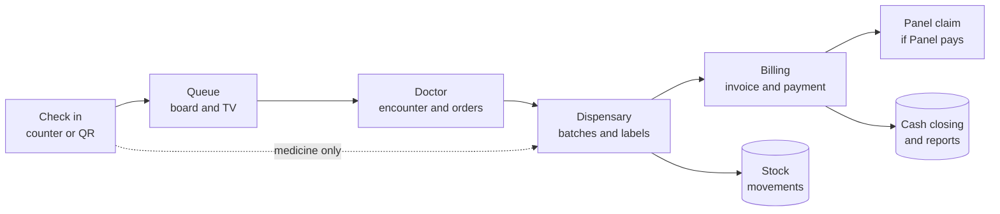

# KPOne

KPOne is Klinik Putrijaya's internal digital operating platform: one system for the front desk, the doctor, the
dispensary, billing, Panel claims, stock, HR and management reporting across the clinic's three branches.

> **Status: not approved for production.** Every record in KPOne today is synthetic. Yezza remains the clinic's
> operational system, and no merged feature or walkthrough implies approval for real patients or staff. The
> authoritative delivery status, limits and release gates are in [docs/BASELINE.md](docs/BASELINE.md).

This repository is a new, independent Laravel application. It does not modify, import from or depend on
`MiniWeb_KlinikPutrijaya_Fullstack`.

## Contents

- [What KPOne does today](#what-kpone-does-today)
- [A patient's visit, end to end](#a-patients-visit-end-to-end)
- [Classic and the new look (V2)](#classic-and-the-new-look-v2)
- [Roles](#roles)
- [Stack and architecture](#stack-and-architecture)
- [Safety rules every change follows](#safety-rules-every-change-follows)
- [Quick start](#quick-start)
- [Demo data](#demo-data)
- [Verification](#verification)
- [How work is organised](#how-work-is-organised)
- [Before real use](#before-real-use)
- [Not built or not authorised](#not-built-or-not-authorised)
- [Documentation map](#documentation-map)

## What KPOne does today

Everything below is merged on `main` and runs on synthetic data only.

### Patients and registration

- One organisation-wide patient record with a stable KP number, NRIC or passport history, masked search and a
  WhatsApp click-to-chat icon (KPOne sends nothing itself).
- Guardian contacts for every minor; staff confirm an adult when the date of birth is unknown.
- Duplicate patients are merged by two people (one proposes, another approves), with a change history that
  shows field names only, never values.
- Counter registration (quick create and full form) creating the canonical Visit, and a Registration board that
  refreshes itself about every 10 seconds.
- Public QR check-in in Bahasa Melayu: the patient fills a form on their phone, a CA reviews and accepts it, and
  the patient's status page shows their queue number once accepted. No patient, visit or queue record exists
  before a person accepts.

### Queue and waiting-room TV

- Consultation queue with branch-local numbers (`A-001`), urgent first, waiting-time colours at 30 and 60
  minutes, held and carry-over lists.
- Call In and a one-press Call next that confirms the named patient and skips patients marked not ready.
- A "not ready to call" flag with controlled reasons, hold and resume (at most three held per doctor), and
  treatment progress steps (nebuliser, drip and others) that alert the doctor when done.
- Each doctor chooses a consultation room for the day.
- Waiting-room TV per branch: current and earlier calls, recall, a chime and spoken call, posters, video and
  scrolling text, "Last called" after 15 minutes, and dispensary and treatment-room calls. Call display by queue
  number (default), short name or full name.

### Consultation and clinical documents

- One in-progress clinical encounter per serving consultation: vitals, a clinical note, ordered diagnoses with
  preset diagnoses, and bounded history summaries.
- Allergy profile with an exact, versioned review per encounter, and a longitudinal problem list.
- Treatment plan with catalogue-backed medicine and service orders; medicine changes require the current allergy
  review.
- Medical certificate, referral letter and attendance confirmation issued by the attending doctor, with numbered,
  encrypted, immutable copies. **All wording is a draft pending a doctor's approval.**

### Dispensary and OTC

- The CA edits, adds, removes or restores the doctor's medicines and services, with the doctor's original kept
  alongside, picks batches earliest-expiry first (a later batch needs a reason) and completes the case.
- Medicine-only (OTC) walk-ins have their own B-number waiting list and TV call.
- Allergy warning: a medicine matching one of the patient's allergies by name, drug group or "other name" shows a
  red warning that the CA must confirm; the confirmation is recorded. It warns and never blocks.
- Barcode scanning to find a medicine, pick a batch (including GS1 batch and expiry) and check a box against the
  saved line. A scan never saves anything on its own.
- The clinic's 100 × 62 mm drug label (size provisional), with a print log and a REPRINT mark; an over-long label
  is blocked, never cut.
- Medicine returns after dispensing, checked by a second CA Supervisor (dispose, quarantine or refuse).

### Billing and payments

- Invoice built from what was dispensed; payments of any method; Panel and pay-later shares within approval
  limits; discounts and surcharges with a branch threshold and a second-person reversal.
- Receipt reversal (never deletion), corrections after completion, and refunds approved by a second person.
- Void and reissue of invoices; voided invoices stay visible.
- Recorded invoice and receipt prints in the clinic's layout (ORIGINAL, COPY, REVISED), Bill to, internal notes and
  an activity log per invoice.
- Bills to collect, daily cash closing (count, then approval by someone else), a monthly cash closing view and
  terminal reconciliation.
- Reports with CSV download: Daily summary, Billing Detail, Transaction Detail, Panel summary, Panel invoices and
  Stock movement. Every download is audited before release.

KPOne records money; it never pays anyone, and it has no tax or e-Invoice fields yet.

### Panel claims

- Pending and overdue Panel invoices, single and bulk claim creation (up to 20 invoices of one Panel).
- Claim page with documents, photos, payments, notes, query and decision tracking, logs and a copy-ready message.
- Printable claim pack (cover plus one page per claim, up to 50 claims).
- Panel payments split across claims, with a helper that fills the split from the Panel's CSV statement, and
  payment correction by a second person.
- Follow-up list, Panel summary with ageing, and Panel settings with due rules and a claim message template.

### Inventory and stock

- One verified stock unit per medicine, locations (dispensary, store, patient returns), batches with real expiry
  dates, and opening stock signed off by a second person, including a CSV import.
- Purchase requests, purchase orders (raised and approved by different people, printable), supplier price lists,
  reorder suggestions and branch replenishment.
- Verified receiving against an order with split lots, accepted, quarantined or rejected outcomes, independent
  approval of delivery problems and reversing corrections.
- Supplier invoices matched three ways against order and receipt (no payment in KPOne), supplier returns,
  transfers between branches with shortages resolved by another person.
- Governed stock counts and write-offs with an independent recount, counts due by ABC class, treatment-room usage
  and waste, stock review, batch holds and recalls across branches.
- Controlled-medicine register (draft, pending pharmacist review) with second-person checks and a blind count.
- Stock value, cost of goods, margin and losses for the Director only, labelled as KPOne's default cost policy
  pending the accountant, and a monthly journal summary CSV.

### Catalogue and settings

- Medicine catalogue (controlled flag, drug groups, other names for allergy matching), clinical service catalogue
  and consultation tariff.
- Versioned pricing with price books, a price list check showing what billing would charge, and price history.
- Business details per branch (name, address, two phones, logo, print footer) with a document readiness card.
- Payment methods (Cash or Non-cash), suppliers, medicine detail options, registration and consultation settings.

### KPOne HR

- Weekly roster per branch drafted by HR and approved by the Director, open shifts, and staffing warnings.
- Leave types and entitlements set by the clinic, apply and approve, a balance ledger, MC files and a team calendar.
- Attendance: clock in and out with a compulsory photo, an optional location check, undo within 15 minutes,
  corrections, overtime and summaries.
- Staff files with encrypted personal and bank details behind an audited Show, a document vault, and onboarding
  and offboarding checklists.
- Credentials with expiry reminders, SOPs with read-and-acknowledge, memos and an HR dashboard.
- Staff claims (approved by one person, marked paid by another).
- Payroll: pay profiles, statutory tables entered by the clinic (KPOne ships no statutory numbers), monthly and
  adjustment runs, the Director's approve and lock, payslips, and bank and accountant CSVs. KPOne pays nothing and
  files nothing.
- Letters, appraisals, restricted discipline cases and incident reports.
- Job applications with a public bilingual form (switched off), hiring stages and interview slots.

### Agents and management

- Daily summary built at 07:00 and updated at 14:00 per branch, showing each person only what their permissions
  allow. Nothing is sent to anyone.
- Approval inbox for rule-based stock suggestions; an approval records the decision only and changes no stock.
- Agents for stock counts, reports and system health, Director quick answers from fixed queries, and an agent
  office view.
- Aggregate Insights for Today, Sales, In-clinic, Payments, Inventory and Patients.
- **KPOne calls no AI service.** A test fails if any code names an AI provider.

### Staff shell

- Staff accounts created only through the governed provisioning service (no public registration), roles,
  effective-dated branch assignments, Google sign-in for existing accounts only, and a full audit log.
- Clinic management hub with a page search, phone and tablet layouts, dark mode and screen-reader names.
- Draft Malay quick guides for the CA, the doctor, the CA Supervisor and all staff in
  [docs/guides/ms](docs/guides/ms).

### Website content (draft only)

- Private drafts of branch profiles, doctor profiles, careers, services, promotions, activities, FAQs and the
  Little Shield programme, with a frozen release, an output plan and a private static renderer. Nothing is
  published.

## A patient's visit, end to end



## Classic and the new look (V2)

Every main staff page exists in the Classic look, and most also have a new look (V2). Staff switch with
"Try the new layout" and "Back to Classic"; both use the same server code, permissions and requests. V2 pages are
registered in `config/v2-pages.php`.

| Area                                                      | New look                                                                |
| --------------------------------------------------------- | ----------------------------------------------------------------------- |
| HR, Inventory, Dispensary, Catalogue and settings, Agents | All staff pages (print pages stay Classic by design)                    |
| Patients and Registration, Queue                          | All but a few (QR review list; three sections of the consultation page) |
| Staff Experience                                          | Most (Dashboard and personal settings remain Classic)                   |
| Panel                                                     | 3 of 9 pages                                                            |
| Billing                                                   | 3 of 11 pages                                                           |
| Sign-in, Website admin, Careers, Insights                 | Classic only                                                            |

Overall, about 100 of 158 staff pages have a new look (17 Nov 2026).

## Roles

Roles and permissions are separate; permissions carry an explicit `.own`, `.branch` or `.organisation` scope. The
source of truth is `app/Domain/Access/PermissionCatalogue.php` with `BillingPermissions`.

| Role                                | Typical work                                                    |
| ----------------------------------- | --------------------------------------------------------------- |
| `director`                          | Oversight, approvals, cost reports, staff authority             |
| `resident_doctor`                   | Consultations, treatment plans, clinical documents              |
| `ca`                                | Registration, queue, dispensary, billing at the counter         |
| `ca_supervisor`                     | Supervision, stock control, second-person checks                |
| `finance_officer`                   | Payments, refunds, cash closing approval, reports               |
| `panel_officer`                     | Panel claims, Panel payments and follow-up                      |
| `administrator`                     | Catalogue, prices and settings; no patient data                 |
| `hr_manager`                        | KPOne HR                                                        |
| `technical_admin`                   | Technical administration; never clinical content by implication |
| `marketing`, `business_development` | Website drafts and directory access                             |
| `queue_display`                     | The shared waiting-room TV account; display only                |

A locum sign-in exists for HR-created locum accounts only.

## Stack and architecture

| Layer    | Technology                                                                             |
| -------- | -------------------------------------------------------------------------------------- |
| Server   | PHP 8.4, Laravel 13                                                                    |
| Screens  | Vue 3, TypeScript, Inertia 3, Tailwind CSS 4, shadcn-vue                               |
| Database | PostgreSQL 18 (SQLite only for the default local PHPUnit run)                          |
| Access   | Spatie Laravel Permission, Laravel Fortify, Socialite (Google, existing accounts only) |
| Tests    | PHPUnit with ParaTest, Node's built-in test runner for frontend checks                 |

- **Modular monolith:** one Laravel app and one PostgreSQL database; no microservices, brokers or Kubernetes.
- **Business rules live in `app/Domain`**, never only in controllers or Vue: Access, Agents, Audit, Clinical,
  DepartmentSpace, HR, Identity, Organisation, Patient, Queue, Shared and Visit (about 246 services).
- **Data:** patients are organisation-level; visits, queue entries, encounters and stock belong to a branch. Staff
  branch relationships live in `staff_branch_assignments`. Internal numeric keys; timestamps in UTC, localised to
  the branch time zone only on screen and in prints.
- **Migrations are additive** (about 266); PostgreSQL triggers and checks back up the domain rules for append-only
  evidence such as audit, payments, stock movements and issued documents.

Read [docs/ARCHITECTURE.md](docs/ARCHITECTURE.md) and [docs/SECURITY.md](docs/SECURITY.md) for detail.

## Safety rules every change follows

Every state-changing operation:

1. checks the permission and the branch on the server (screens only hide buttons for convenience);
2. runs in a database transaction with row locks;
3. uses an optimistic `lock_version` so a stale screen cannot overwrite newer data;
4. takes an idempotency key where a retry is possible, so a double click saves once;
5. writes an audit record with ids and codes only, never credentials, tokens or secret values.

Other standing rules:

- Never create, read, print or commit a real `.env`; work from `.env.example` only.
- Use fictional `.test` identities; never add real patient or staff data.
- Staff screens are in English; patient-facing screens (the QR form and status page) are in Bahasa Melayu.
- Staff role, branch and status changes reject self-escalation and targets with greater authority.
- Two-person races are tested for real: about 104 test files run two-process PostgreSQL contention
  tests in a serial suite.

The full rules are in [AGENTS.md](AGENTS.md) and [CLAUDE.md](CLAUDE.md).

## Quick start

See [docs/DEVELOPMENT.md](docs/DEVELOPMENT.md) for PostgreSQL 18 setup and the full workflow.

```bash
composer install
```

```bash
npm ci
```

```bash
php artisan key:generate
```

```bash
php artisan migrate --seed
```

```bash
npm run dev
```

Only `.env.example` is versioned. Never commit credentials or a real `.env` file. Start any test or preview server
with explicit database settings for a database you own, and check the effective database before the first request.

The development seeder creates one fictional account in `local` and `testing` environments only:

- Email: `dev.admin@kpone.test`
- Password: `KPOne-Dev-Only!`

This account must never be enabled or replicated in production. The first real Director is created with the
interactive bootstrap command described in [docs/DEVELOPMENT.md](docs/DEVELOPMENT.md#first-director-bootstrap).

## Demo data

For a walkthrough on a disposable database (local or testing environments only; every seeder refuses other
environments and any email not ending in `.test`):

```bash
php artisan migrate:fresh --seed
```

```bash
php artisan db:seed --class=KPOnePresentationSeeder
```

```bash
php artisan db:seed --class=KPOneDemoSetupSeeder
```

```bash
php artisan db:seed --class=KPOneInventoryWalkSeeder
```

This gives one demo branch (Cheras) with demo accounts for every role, six medicines with stock and prices, a
store, two fictional suppliers, a controlled medicine and a purchase order ready to receive. The first command
wipes the database: run it only on a database that exists for the demo.

## Verification

Run the full gate before handing off a change:

```bash
php artisan test
```

```bash
composer run lint:check
```

```bash
composer run types:check
```

```bash
npm run types:check
```

```bash
npm run lint:check
```

```bash
npm run format:check
```

```bash
npm run build
```

```bash
node --test tests/Frontend/*.mjs
```

```bash
git diff --check
```

Migration and seed verification belongs on a local or disposable test database only:

```bash
php artisan migrate:fresh --seed
```

PostgreSQL contention tests need a disposable database whose name ends in `_test` or `_testing`; a skipped
PostgreSQL test is not release evidence. GitHub Actions runs the static checks, parallel Unit and Feature tests and
the serial Contention suite on PostgreSQL for every pull request, and attests that the tested commit contains the
current `main`.

## How work is organised

- Ten area teams build KPOne, each with a lead who builds and a reviewer who checks: Agent platform, Dispensary and
  OTC, Inventory, Billing, Panel, Patients and Registration, Queue and TV, Staff Experience, Catalogue and settings,
  and HR. Each team keeps its memory in `docs/teams/<area>/TEAM.md`.
- A design lead owns [docs/design](docs/design) (guide, checklist, review loop and the design debt list) and reviews
  every new or changed screen.
- A coordinator assigns work, relays the owner's decisions and merges only after green checks on the exact latest
  code. Money, migration and payroll changes merge one at a time.
- Branches are named `feature/<id>-<slug>`, `fix/<id>-<slug>` or `validation/<id>-<slug>`. Nothing reaches `main`
  without review and green CI.

Release flow: implementation → independent review → user acceptance → freeze the candidate commit → PostgreSQL 18
validation → pull request to `main` → GitHub Actions → merge → post-merge CI.

## Before real use

These need people, decisions or real-world tests, not code:

- **Privacy (PDPA) review** before any real data, including clock-in photos and location, bank details, job
  applications, Panel statement files and the masked read-only "Ask KPOne" schema.
- **A doctor** approves the medical certificate, referral and attendance wording.
- **A pharmacist** reviews the drug label, the controlled-medicine register and the expiry (FEFO) rules
  ([docs/pilot](docs/pilot)).
- **The clinic's accountant** confirms the payroll statutory tables and MTD schedule, the stock cost policy and the
  journal CSV, and any tax or e-Invoice requirement.
- **Real hardware tests:** label printer and sticker size, invoice and receipt printing, the A4 Panel claim pack and
  the waiting-room TV (sound, voice, staying signed in overnight).
- **Clinic setup:** the real catalogue, prices and units, each branch's print footer and the Panels
  ([docs/pilot/SETUP-LIST.md](docs/pilot/SETUP-LIST.md)).
- **Owner decisions:** who lifts a stock recall when there is one Director, a clinical reviewer for patient-care
  incidents, and keeping the TV on queue numbers until the name modes pass the privacy review.
- **Production gate:** an approved server, a proven backup and restore, access and security review, PDPA and legal
  approval, OPcache and cached configuration, a running scheduler and a direct database connection.

## Not built or not authorised

Planned but not built: the new look for the remaining Billing and Panel pages and three consultation sections, HR
clinic compliance (licences, audit checklist, vaccine fridge log), HR shift swaps, and the Panel frozen claim pack.

Not authorised (each needs a separate owner decision): appointments, a patient portal or patient login, messages to
patients (SMS, WhatsApp beyond a click-to-chat link, email, OTP), AI service calls from KPOne, Yezza integration or
data migration, website publishing and deployment, production stock migration, and production go-live. See
[docs/BASELINE.md](docs/BASELINE.md) section 4.

## Documentation map

| Document                                                                           | What it covers                                                                        |
| ---------------------------------------------------------------------------------- | ------------------------------------------------------------------------------------- |
| [docs/BASELINE.md](docs/BASELINE.md)                                               | Authoritative delivery status, owner decisions and open issues                        |
| [PROJECT.md](PROJECT.md)                                                           | Vision, phase history and merged deliveries                                           |
| [AGENTS.md](AGENTS.md), [CLAUDE.md](CLAUDE.md)                                     | Non-negotiable boundaries and working rules                                           |
| [docs/DEVELOPMENT.md](docs/DEVELOPMENT.md)                                         | Local setup, bootstrap, demo data and commands                                        |
| [docs/ARCHITECTURE.md](docs/ARCHITECTURE.md), [docs/SECURITY.md](docs/SECURITY.md) | Architecture and security model                                                       |
| `docs/PHASE_*.md`                                                                  | Design and boundaries of each core phase (0A to 3B)                                   |
| [docs/INSIGHTS.md](docs/INSIGHTS.md)                                               | Insights metrics, filters and limits                                                  |
| [docs/design](docs/design)                                                         | Design guide, checklist, review loop and design debt                                  |
| [docs/agents](docs/agents)                                                         | Agent platform contract, briefs and runbook                                           |
| [docs/pilot](docs/pilot)                                                           | Pilot setup list and review packs (labels, controlled register, HR, inventory, Panel) |
| [docs/guides/ms](docs/guides/ms)                                                   | Draft Malay staff quick guides                                                        |
| `docs/teams/<area>/TEAM.md`                                                        | Each team's scope, decisions and backlog                                              |
| [docs/reports](docs/reports)                                                       | Delivery and analysis reports                                                         |
