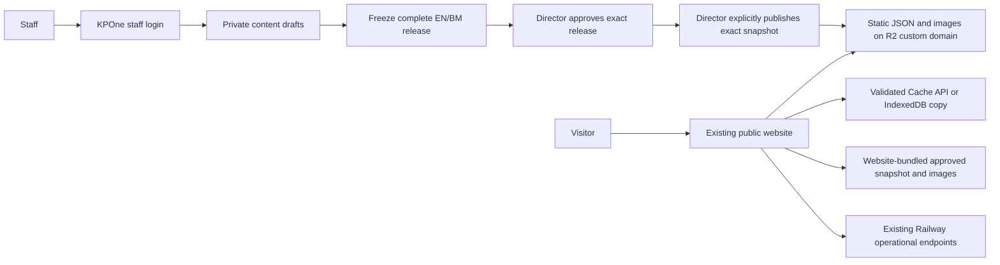

# Website snapshot contract — version 1

Owner-approved direction, 2026-10-29. **Only PR 1 (documentation and guardrails)
is authorised now.** This document specifies future behaviour; it does not claim
that an exporter, publisher, route, permission, configuration flag or deployment
exists. Do not begin PR 2 until the owner separately instructs it. No production
provisioning, deployment or cutover is authorised by this document.

The existing website keeps its presentation, extensionless URLs and service-detail
query URLs. KPOne remains independent of MiniWeb code, its database and runtime
availability. The interface is static public JSON and images, not imported code.

## 1. Data flow and authority



Public visitors must not call KPOne for content or images. There is no anonymous
KPOne content API, public KPOne image route or KPOne-side CORS policy for visitor
content reads. The publish action is an authenticated, authorised, CSRF-protected
staff action, not an anonymous endpoint. Existing operational routes and their
security boundaries are outside this change.

Only an authorised Director may publish or restore a previous publication. Do not
add other publishing roles or treat a technical administrator's platform access as
publication authority. Another publishing role requires a separate owner decision.
Existing content editors and release preparers do not acquire publishing authority.

Approval alone does not publish. Both EN and BM must remain complete for release
approval; initial public output is English only. Draft saves cannot change public
content. Use the exact approved frozen release and frozen reviewed aliases, never
live draft rows, live operational records or the private renderer's page output.
The existing private renderer remains separate; do not replace the public website
with it or apply its design, About-page or logo choices to MiniWeb.

## 2. File layout and identifiers

```text
current.json
releases/
  <publication-id>/
    snapshot.json
    images/
      <sha256>.jpg
      <sha256>.png
      <sha256>.webp
```

Each publication directory is immutable and self-contained. Publication IDs and
content IDs are opaque public strings, never internal numeric database IDs or
booking identifiers. `WEB/2026/000001` illustrates a release-number format, not a
filesystem path. Hashes are lowercase, 64-character SHA-256 hexadecimal strings.

Paths are relative, contain no credentials, query, fragment, traversal or encoded
path separators, and resolve only within the configured snapshot origin and
publication directory. The website must not accept a URL supplied by a query
parameter, draft or arbitrary content field as its snapshot destination.

### current.json

All fields below are mandatory. The pointer contains no content or private history.

| Field | Type and rule |
|---|---|
| `schema_version` | Integer `1`; pointer schema version. |
| `generation` | Positive integer incremented on every activation, including rollback. |
| `publication_id` | Selected immutable publication ID. |
| `release_number` | Approved frozen source release number. |
| `release_hash` | SHA-256 of the approved source manifest. |
| `published_at` | Original snapshot publication timestamp, UTC ISO-8601 with `Z`. |
| `activated_at` | Timestamp of this pointer selection, UTC ISO-8601 with `Z`. |
| `snapshot_path` | `releases/<publication-id>/snapshot.json`. |
| `snapshot_sha256` | SHA-256 of the exact served `snapshot.json` bytes. |

Rollback may select a lower release number. Clients compare activation generation,
not release number or `published_at`, to recognise a new selection. Pointer and
bundle publication ID, release number/hash and publication timestamp must agree.
A hash verifies integrity relative to the pointer, not independent publisher
identity; HTTPS, credential protection and storage access remain trust boundaries.

### snapshot.json envelope

All fields are mandatory; no additional top-level fields are allowed in v1.

| Field | Type and rule |
|---|---|
| `schema_version` | Integer `1`; bundle schema version. |
| `publication_id` | Opaque public publication ID matching the pointer. |
| `release_number` | Approved frozen source release number. |
| `release_hash` | Approved source manifest's SHA-256, distinct from the output hash. |
| `published_at` | Original publication timestamp, UTC ISO-8601 with `Z`. |
| `language` | Literal `en`. |
| `domains` | Object containing exactly the eight domain keys below. |
| `media` | Array of public media records defined below. |

The source release hash does not hash the generated bundle. Avoid a self-referential
output hash: `snapshot_sha256` belongs in the pointer. A bundled website baseline
preserves this envelope and original `published_at`; copying or deploying it does
not create a newer content publication timestamp.

## 3. Domain schemas

This is the normative v1 field/type contract. Notation: `string[]` is an ordered
array of plain strings; `id[]` contains opaque public references; `media?` is a
media ID or `null`; `date?` is `YYYY-MM-DD` or `null`. Optional prose uses an empty
string, never markup. Every listed record key is present, unless explicitly noted.

Every domain is `{status, data}`, where `status` is `included` or `not_managed`.
For `not_managed`, `data` is `null` and the corresponding website flag must remain
disabled. All eight domain keys are required even during partial migration.
An included empty array is an intentional empty collection, not an outage. Included
singleton pages may be `null` to represent intentional absence. A domain is enabled
only once its data and all referenced dependencies are included and validated.

| Domain | Included `data` schema |
|---|---|
| `categories` | Array of `{id:string, slug:string, name:string, description:string, parent_id:string\|null, sort_order:integer}`. |
| `services` | Array of `{id:string, slug:string, category_id:string, title:string, summary:string, sections:Section[], what_to_expect:string[], suitable_for:string[], price_text:string, branch_ids:id[], cover_media_id:media?, gallery_media_ids:id[], seo:Seo, sort_order:integer}`. |
| `doctors` | Array of `{id:string, name:string, professional_title:string, biography:string, qualifications:string[], areas_of_practice:string[], languages_spoken:string[], branch_ids:id[], portrait_media_id:media?, sort_order:integer}`. No registration number or registration text. |
| `branches` | Array of `{id:string, slug:string, name:string, address:Address, public_phone:string, whatsapp_number:string, public_email:string, map_url:string, opening_hours:Hours, hours_note:string, parking_notes:string, accessibility_notes:string, contact_blocks:ContactBlock[], hero_media_id:media?}`. |
| `promotions` | Array of `{id:string, title:string, summary:string, sections:Section[], offer_text:string, terms:string[], valid_from:date?, valid_until:date?, branch_ids:id[], cover_media_id:media?, sort_order:integer}`. |
| `activities` | Array of `{id:string, title:string, summary:string, sections:Section[], location_note:string, starts_on:date?, ends_on:date?, branch_ids:id[], cover_media_id:media?, gallery_media_ids:id[], sort_order:integer}`. |
| `little_shield` | Object or `null`: `{title:string, tagline:string, introduction:string, overview_paragraphs:string[], pillars:Card[], flow_steps:Card[], medical_safeguards:string[], partnership_introduction:string, partner_types:Card[], how_to_take_part:string, branch_ids:id[], cover_media_id:media?, poster_media_ids:id[]}`. |
| `site_settings` | Initially `{status:"not_managed", data:null}`. Reserved future included schema: `{site_name:string, tagline:string, footer_summary:string, ownership_statement:string, logo_media_id:media?, default_seo:Seo, social_links:SocialLink[]}`. New site-settings functionality remains separately unauthorised. |

Shared structures:

| Structure | Fields |
|---|---|
| `Section` | `{heading:string, body:string}`. |
| `Card` | `{title:string, description:string}`. |
| `Seo` | `{title:string, description:string}`; never scripts or raw HTML. |
| `Address` | `{line_1:string, line_2:string, postcode:string, city:string, state:string}`. |
| `ContactBlock` | `{label:string, text:string}`. |
| `Hours` | Exactly `mon`, `tue`, `wed`, `thu`, `fri`, `sat`, `sun`, each `{closed:boolean, open:string, close:string}`; closed days have empty times, otherwise `HH:MM`. Preserve current completeness and no-overnight validation. |
| `SocialLink` | `{channel:string, url:string}`; future bounded approved channel/HTTPS-host allowlist, not arbitrary navigation or redirects. |

All IDs are unique within their domain. Categories have at most two levels; a
subcategory references an included top-level category, with no cycles. Services
reference an included category/subcategory appropriate to the frozen hierarchy.
Branch/media references resolve within the same bundle. Arrays preserve frozen
editorial order; ties must be deterministic. Slugs are unique within their kind,
match the reviewed alias map and retain existing public URLs. No aliases are read
from mutable draft rows at publication time.

Existing validators remain the field/list budgets for corresponding content:
`WebsiteProfileFields`, `WebsitePeopleFields`, `WebsiteServiceFields`,
`WebsiteEditorialFields` and `WebsiteLittleShieldFields`. Adapters rename fields;
they do not relax validation. Before PR 2 implementation is accepted, document and
test explicit aggregate record, JSON-byte and image-byte limits based on a synthetic
full-site fixture; do not introduce unbounded exports or silently truncate records.
This is an implementation gate, not permission to start PR 2 now.

Map public price wording only; do not fetch clinical catalogue or billing prices.
Do not invent legacy CTA, badge, featured, result-time or structured-price fields
that do not have approved frozen equivalents. Resolve required display gaps before
that domain's cutover. Version 1 includes no arbitrary promotion CTA link; appointment
links are system-controlled and generic. FAQs and careers are not public domains in
this contract even though private KPOne drafts exist.

## 4. Media and exclusions

Each `media` record has exactly:

```text
{id:string, path:string, sha256:string, mime:string,
 bytes:positive-integer, width:positive-integer, height:positive-integer, alt:string}
```

`path` is `images/<sha256>.<jpg|png|webp>` relative to `snapshot.json`. MIME,
extension, decoded dimensions, byte count and SHA-256 must agree. Use only sanitised
retained image bytes referenced by the exact approved release, not the live media
library or private generated renderer output. Existing image size/content validation
and rights/consent checks stay in force. Export approved English alt text, never
rights or consent evidence. No SVG, HTML, scripts, executable metadata or remote
image-fetch mechanism is introduced. Every referenced image must be present before
activation; unresolved media makes publication invalid.

The public projection is an explicit allowlist; never serialize the release
manifest, model, draft JSON or operational record wholesale. Exclude:

- Drafts, internal notes, omissions, revision provenance and source database IDs.
- Approval, registration-display, price-display, offer-display, consent and rights
  references; staff approvers, uploaders and their account/contact details.
- Doctor registration numbers and registration text, even where an older frozen
  projection or the legacy website contains them.
- Patients, clinical records, bookings, feedback, staff-account records, analytics,
  performance and operational data; credentials, tokens and private storage paths.

Deliberately authored public doctor names and clinic contact details are public
editorial fields, not permission to source staff identities or operational contacts.
Do not import MiniWeb records, code or images under this authorisation.

## 5. Hosting, credentials, headers and CORS

Decision: Cloudflare R2 Standard behind a dedicated custom subdomain, never
`r2.dev`. The exact public domain is **owner to confirm** and remains configuration.
A separate snapshot bucket isolates it from private KPOne storage and website code.
Pages was considered but would require separate deployment orchestration; R2 fits
immutable content objects plus one pointer without deploying website code.

The owner holds Cloudflare administration. KPOne receives only an Object Read &
Write upload credential restricted to the snapshot bucket, stored in the hosting
provider's secret store and accessed through server-side Laravel configuration.
It receives no account-admin, DNS, Pages-deployment or private-storage credential.
Bucket-level permission does not promise prefix-level or write-only isolation.
Administrative provisioning and emergency recovery use the owner's separate access.
Local tests use local static output or a separate test bucket and synthetic content;
never production credentials or a real `.env` in agent work.

No credential goes to the website, snapshot, Git, browser response or logs. Restrict
outbound upload destinations to reviewed configuration, retain HTTPS verification,
use bounded timeouts/retries, and do not add a dependency without separate review.
Provider credential revocation/rotation requires explicit owner approval.

| Resource | Required delivery policy |
|---|---|
| `current.json` | `Cache-Control: no-store`; explicit CDN cache bypass. Browser fallback caching is deliberate application storage, not HTTP pointer caching. |
| Immutable `snapshot.json` | `Cache-Control: public, max-age=31536000, immutable`. |
| Hashed images | `Cache-Control: public, max-age=31536000, immutable`. |
| Missing objects / errors | No negative caching on publication paths; verify edge behaviour. |
| All objects | Correct JSON/image content type; enforce `X-Content-Type-Options: nosniff` through the chosen delivery configuration and verify it. |

Snapshot-host CORS allows exact configured website origins, GET/HEAD, no credentials,
and no wildcard origin. Configure permitted staging/local origins separately from
production. Permit only required request headers; expose ETag only if the client
actually needs it. Verify Origin-varying responses cannot leak an incorrect cached
CORS header, including requests with no Origin. CORS is a browser access policy,
not access control: published objects are public to everyone. Do not weaken any
existing KPOne or Railway protections. Recheck cached headers after policy changes.

Pricing reference, checked during planning on 2026-10-29: R2 Standard includes
10 GB-month, one million Class A operations and ten million Class B operations per
month; listed excess rates are USD 0.015/GB-month, USD 4.50/million Class A and
USD 0.36/million Class B, with no internet egress charge. These are not a cost
promise: retaining every publication and duplicating images consumes storage.
Recheck rates and account settings before provisioning; set owner-visible usage
monitoring. Sources: [pricing](https://developers.cloudflare.com/r2/pricing/),
[bucket-scoped credentials](https://developers.cloudflare.com/r2/api/tokens/),
[public domains](https://developers.cloudflare.com/r2/buckets/public-buckets/),
[CORS](https://developers.cloudflare.com/r2/buckets/cors/).

## 6. Publish, activation and restoration

Only an authorised Director performs publish or restore through authenticated
staff actions. Preserve active-account rejection, CSRF, session security, scoped
authorisation, rate limits and safe audit. Publishing authority must be rechecked
server-side; UI visibility is never the boundary. No roles or permissions are
changed in PR 1.

1. Validate the Director, organisation, exact approved release/hash and frozen
   reviewed aliases. Check EN/BM completeness and all dependency/consent rules.
2. Generate candidate JSON and images privately from frozen data; run schema,
   exclusion, URL/reference, hash and size-budget validation. Present the exact
   candidate and output hash for explicit Director publication confirmation.
3. Record idempotent publication intent. Upload only those explicitly authorised
   public bytes under a new immutable publication ID; never stage drafts publicly.
4. Use create-once writes for release objects. Verify the uploaded bytes and public
   accessibility of the complete bundle and every referenced image before activation.
5. Recheck release approval and Director authority. Serialise publish, restore and
   approval withdrawal against the same authority/version boundary; define and test
   their lock order in the later implementation. Activate only by conditionally
   replacing `current.json` against the expected ETag, with a higher generation.
6. Verify the selected pointer and reconcile the append-only KPOne publication and
   audit evidence. Do not report a definitive failure after an ambiguous write
   response without reading the authoritative pointer.

Multi-object upload is not atomic. **Activation is atomic at the single pointer**:
old and new pointers each refer to complete immutable publications. Never overwrite
an existing publication in place, and never update a pointer to an incomplete set.
Use conditional object writes to avoid racing publishers. CDN caches must not
obscure the mutable pointer or retain a pre-upload 404. Provider references:
[R2 consistency](https://developers.cloudflare.com/r2/reference/consistency/) and
[conditional writes](https://developers.cloudflare.com/r2/api/s3/extensions/).

PostgreSQL and R2 do not share a transaction. Persist intent, use idempotency and
conditional activation, and reconcile uncertain success after crashes/timeouts.
Failed uploads leave the previous selection unchanged. A completed pointer change
with incomplete local evidence is a reconciliation case, not permission to blindly
retry, overwrite or auto-restore. Competing conditional updates must fail visibly
and reload their expected selection.

A single **Restore previous publication** action by an authorised Director verifies
the previous target's retained objects, approval and eligibility (including no
exceptional takedown), then conditionally activates it with a higher generation.
Retain the target's original `published_at`; write the new `activated_at`. Do not
silently choose the newest approved release or restore withdrawn/taken-down data.
Retain enough private activation history to identify the previous eligible target.

Ordinary snapshot publish/restore does not deploy website code. Infrastructure
provisioning, actual deployment and public cutover remain separate approvals.

## 7. Cache, staleness and fallback policy

Use the **Cache API or IndexedDB**, never localStorage for snapshots or images.
Browser eviction, quota exhaustion, storage refusal and private-mode limitations
are normal. Cache size is not guaranteed. A candidate becomes last-known-good only
after JSON validation, complete required image staging and an atomic local selection
change; partial downloads must not evict the last complete version. Store sufficient
release metadata to verify and select cached versions. Browser storage layout is a
later implementation choice, not permission to store operational data.

Every website deployment that enables a domain includes a complete approved
baseline snapshot and its referenced images on the website's own origin. This is
the **guaranteed fallback while that website origin is reachable**, independent of
browser storage and R2. Retain its original `published_at`, so age is recognisable;
show a quiet "Content last published {date}" indication when fallback content is
used. Do not relabel an old baseline with its deployment time.

**Refresh the bundled baseline on every website release and at least monthly.**
If no website release otherwise occurs, make a baseline-refresh release that month.
Select the latest eligible approved publication and verify its hashes, all enabled
domains and images; document the refresh date separately from `published_at`. If no
new publication exists, revalidate and record the existing baseline without
falsifying its age. If R2 is unavailable, use a previously verified retained copy;
if no eligible complete copy can be verified, block the new release and escalate
the missed refresh rather than shipping an unvalidated fallback. Assign the
baseline-refresh owner before cutover; this document creates no scheduler/workflow.

| Failure / state | Exact public behaviour |
|---|---|
| Snapshot host unreachable, timeout, DNS, CORS or HTTP failure | Render complete validated browser last-known-good content; if absent, render bundled baseline. Show the fallback publication date, not an error page. Never call MySQL for a cut-over domain. |
| JSON invalid, hash mismatch, unsafe references or wrong schema version | Reject the whole candidate; retain current good content/cache or use the baseline. Do not overwrite last-known-good. |
| One required domain missing | Reject the whole candidate to preserve release consistency; retain the previous complete snapshot or baseline. Do not mix domains from different releases. |
| Included collection empty / included singleton `null` | Accept intentional removal; show the normal empty state, such as "No current promotions". Do not resurrect older items. |
| Domain `not_managed` | Its migration flag remains disabled; enabling it fails the website release gate. |
| Browser cache evicted, denied or full | Use in-memory good data for the current page; use bundled baseline if no complete persistent copy survives. Treat this as normal fallback. |
| One image fails after activation | Use its verified cached bytes; otherwise a bundled placeholder. Preserve text and layout. |
| KPOne unavailable | Published website content continues from R2/cache/baseline; staff login and publishing may be unavailable. |
| New service URL absent from the fallback | If present in a good cached/bundled snapshot, render it. Otherwise retain the service shell, contact navigation and generic appointment link with "Please contact the clinic to confirm this service." Do not invent details or use a content error page. |
| Website origin itself unreachable | No first-visit availability guarantee is possible; R2/browser caching is not a substitute for website hosting availability. |

Preserve stale approved prose during outages; do not claim it is current. Apply
promotion date windows in Asia/Kuala_Lumpur to cached content too; expired offers
must not reappear through fallback. An outage is not proof that a service was
removed. A valid current snapshot's intentional removal is different from an
unavailable or rejected snapshot.

Cached content is continuity, not guaranteed freshness. A cold visitor cannot
recover new content present only on unreachable R2. Immediate recall of offline
copies is impossible; retention/takedown below makes that limit explicit.

## 8. Website adapter, SEO and operational isolation

The future website adapter fetches `current.json` without credentials or legacy
admin headers, validates its paths/version, fetches and hashes the exact bundle,
validates every domain/reference, stages media, then activates one complete snapshot.
All page scripts read that selected version rather than independently fetching
content. Use bounded timeouts/retries and no more than one pointer refresh per
minute while visible, plus navigation/visibility-return checks with the same bound.
Rendering starts from good cached/baseline content instead of waiting on R2.

Prefer `textContent`. Escape every dynamic text/attribute value reaching `innerHTML`
or `insertAdjacentHTML`; separately validate HTTPS URLs, schemes and approved hosts.
Keep HTML structures, classes, appointment destinations and structured-data templates
controlled by code. Never treat upstream plain-text validation as sufficient DOM
escaping. IDs remain strings; do not apply legacy numeric-ID coercion.

Service detail pages resolve the existing `?slug=` against the selected snapshot
and render sections, galleries, branch coverage, related services and SEO metadata.
Preserve extensionless routes, canonical conventions, current layout and branch
URLs. Service cutover requires sitemap parity with the published service set in a
separately reviewed website-side slice; MySQL must not remain sitemap authority for
migrated services. Do not invent structured data or permanently mark a service
removed merely because only fallback data is available. No clean-URL migration or
KPOne-renderer replacement is authorised.

Keep existing `/admin` and `/admin-approvals` functional with their own authentication.
Staff Login navigation uses the configured KPOne URL, existing intended-destination
flow and `/workspace` default; no token sharing, implicit account provisioning or
arbitrary return URL. The legacy dashboard remains available directly during
migration. Login and content flags are independent.

Bookings, feedback, uploads, performance and admin-users stay on Railway/MySQL.
Content read methods must be separate from operational form lookups; KPOne IDs
never become booking IDs. Migrated service pages use generic appointment links
without service/branch preselection until a separately approved mapping exists.
Domains not yet cut over retain their legacy source; a cut-over domain must never
silently fail back to MySQL. Keep taxonomy/services dependencies consistent.

## 9. Configuration and rollback targets

Proposed website configuration defaults (documentation only; no config added):

```json
{
  "staffLoginEnabled": false,
  "staffLoginUrl": "",
  "snapshotContentEnabled": false,
  "snapshotBaseUrl": "",
  "enabledDomains": []
}
```

The Staff Login URL and snapshot base URL remain **unset**. Missing or invalid
values do not enable an integration. An enabled domain requires included validated
data/dependencies and a bundled fallback. Site settings remain disabled. Preserve
the legacy operations API configuration independently. Before initial cutover,
disabled integrations retain current public behaviour and legacy Staff Login.

Website flags, URLs and domain selections are versioned deployment configuration:
**changing them requires a website redeploy**. No query-string/storage flag override
is allowed in production. Local tests use explicit development configuration and
locally served static snapshots, with HTTP allowed only for localhost development;
production destinations require HTTPS. KPOne's storage destination, bucket and
server-side upload secret are separate from public website configuration.

| Rollback | Owner-confirmed target and limits |
|---|---|
| Director restores a prior eligible publication | Five minutes end to end, including verification, on healthy infrastructure. Connected visible pages refresh within one minute plus transfer/validation time. |
| Revert website flags/code to a known good artifact | Ten to fifteen minutes end to end, including deployment and smoke checks. A cut-over domain uses an approved bundled snapshot, never implicit MySQL reactivation. |
| Offline client or unreachable snapshot host | No bounded remote rollback time; retain good cached/bundled content until connectivity returns. |

Measure both targets in a drill before cutover; they are acceptance targets, not
measured promises. Returning content ownership to MySQL requires an explicit
reviewed migration reversal. Ordinary publication and pointer rollback do not need
a website redeploy. The mandatory baseline refresh does need one.

## 10. Retention and exceptional takedown

Keep **every publication initially**. Review retention three months after the first
production publication; record that review date when production publication is
separately authorised. No automatic pruning or deletion job is authorised now.
Keep private publication/activation evidence and a separately protected recovery
copy; the normal publisher credential must not be the only recovery path.

Rollback changes selection, not the availability of historical immutable URLs or
copies in browsers/CDNs. An exceptional takedown therefore follows a distinct,
owner-controlled procedure, with Director-only publication/restoration unchanged:

1. Record the request, affected public object hashes/paths, scope and decision using
   structural evidence only; never paste sensitive content into logs/issues.
2. Identify every publication, cached baseline and duplicated media object affected.
   Mark them ineligible for future restoration/baseline selection. Stop further
   publication of the affected bytes and choose or prepare an eligible safe snapshot.
3. An authorised Director activates the safe publication. If none is safe, the owner
   authorises a controlled emergency website release with safe static information;
   do not silently reactivate MySQL or bypass approval checks.
4. Under explicit owner approval, the Cloudflare administrator removes/blocks the
   affected public objects and purges affected CDN URLs. Do not mutate historical
   files in place under an existing immutable hash. Recheck direct URLs and alternate
   public access paths; never enable `r2.dev` as a bypass.
5. Replace affected website-bundled baselines/images in an emergency website release.
   Connected clients must not continue selecting a known taken-down cache; the later
   takedown implementation must define/test cache invalidation before cutover. A
   normal pointer rollback alone is not a browser-cache purge mechanism.
6. Verify activation, CDN/public removal, website baseline replacement and restoration
   exclusion, and retain only access-restricted evidence/recovery material under the
   separately approved retention policy. Revoke compromised upload access only with
   explicit owner approval if the incident warrants it.

Offline caches, downloaded images, screenshots and third-party copies cannot be
remotely recalled. Do not promise complete disappearance or a five-minute takedown.
A newly learned takedown must not fall back to a known affected baseline; the safe
replacement baseline is part of the emergency procedure. This runbook documents
future operational requirements, not authorisation to delete or change hosting now.

## 11. Twelve PR-sized slices

These are sequence identifiers, not existing GitHub PR numbers. **Only slice 1 is
authorised now.** Later slices need explicit scope approval in the relevant repo.
Website changes listed here are future work; PR 1 must not touch MiniWeb.

| Slice | Scope and acceptance checks | Rollback |
|---|---|---|
| 1 — Contract and guardrails | Update only AGENTS.md, BASELINE.md and this contract. Verify Director-only publish/restore, exclusions, Cache API/IndexedDB, baseline age/monthly refresh, off defaults, exact file scope and preserved unrelated rules. Run repository checks and report their actual results. | Revert the documentation commit; no runtime behaviour changes. |
| 2 — Private snapshot exporter | Frozen approved source only; explicit schema/exclusions, EN output with bilingual approval prerequisites, aliases, media hashes and documented aggregate budgets. Test forbidden-field absence, dangling references, missing domains and deterministic output. No network publication. | Disable exporter; keep existing draft/review flow. |
| 3 — Publication evidence and controls | New ordered migration and Director-only guarded publish/restore intent, exact candidate confirmation, audit, idempotency and approval/concurrency rules. No other publishing role. Test denial, stale state and rollback. Include apply/recovery/verification plans. | Disable controls; retain evidence and avoid destructive rollback. |
| 4 — Storage publisher | Configured test destination, bucket-scoped secret, immutable uploads, public-object verification, conditional pointer and reconciliation. Test interrupted uploads, competing actions, lost responses and approval withdrawal. | Leave prior pointer selected; disable publishing. |
| 5 — Website adapter and fallback | Flags off; complete bundled baseline with original published_at, Cache API/IndexedDB staging and safe rendering. Test cold visitor, eviction/refusal/quota, invalid schema/hash, missing domain, image failure and no post-cutover MySQL fallback. | Revert adapter before enablement; later use an eligible static baseline. |
| 6 — First domain pilot | Promotions after field mapping approval. Verify desktop/mobile layout, dates, intentional empty states, images, quiet fallback date and zero visitor requests to KPOne. Keep production flag off pending cutover. | Select prior eligible snapshot or bundled baseline. |
| 7 — Remaining content domains | Split into small approved PRs: doctors/branches, services/taxonomy/SEO, activities and Little Shield. Close display gaps; test registration-number absence, contacts/maps, string IDs, generic booking links, service detail and sitemap parity. No new site-settings implementation. | Revert affected domain selection to eligible static baseline; keep dependencies coherent. |
| 8 — Staff Login configuration | URL unset/flag off; test configured local login, existing password/Google intended destinations, signed-in state and direct legacy /admin. No shared auth or new publishing role. | Restore existing configured footer navigation. |
| 9 — Deployment readiness | Review KPOne hosting, PostgreSQL/private media, encryption-key recovery, backups/restore, session/proxy security, publish credential scope, snapshot domain/CORS/cache, monitoring, retention/takedown and monthly baseline owner. No production provisioning or deployment implied. | Keep integrations off; no public cutover. |
| 10 — Separately approved deployment | Obtain explicit approval to provision/deploy KPOne and snapshot hosting. Verify login and hosted snapshot behavior while website integrations stay off; record unset/resolved URLs deliberately. | Roll back deployment; website remains unchanged. |
| 11 — Rollback and outage drills | Publish A/B and restore A; interrupt writes, reconcile lost responses, block R2, test cold/evicted browsers, missing domain, taken-down cache/baseline and zero MySQL fallback. Measure five-minute publication restore and ten-to-fifteen-minute website flag revert. | Remain off if any gate fails. |
| 12 — Separately approved cutover | Obtain explicit approval; enable Staff Login and content domains through separate website releases. Refresh/verify baseline on each release, confirm SEO/contact/booking isolation and monitor. Maintain at least monthly baseline refresh after cutover. | Previous known good website artifact and eligible approved snapshot/baseline; retain legacy /admin. |

Dropped from the earlier API proposal: anonymous KPOne JSON/media routes,
KPOne-side public-read CORS and visitor dependence on Laravel/PostgreSQL. Added:
output schema/hash validation, R2 credential and header verification, publication
reconciliation, complete baseline/cache gates, retention/takedown and timed drills.

## 12. Known gaps and release gates

- Site settings are analysis-only; reserve the schema but keep the domain disabled.
- Existing private releases retain internal provenance and may contain registration
  text: a separate public allowlist is mandatory even for approved releases.
- Legacy structured prices, CTA fields and other display differences require an
  explicit mapping/decision before the affected domain moves.
- Exact snapshot custom domain, Staff Login URL and snapshot base URL remain unset;
  the owner must confirm them before later configured deployment/cutover.
- The owner holds Cloudflare administration. Assign the monthly baseline-refresh
  and incident operators before cutover, without granting new publishing roles.
- Cache eviction and first visits require a baseline; offline freshness/recall is
  impossible. R2 and Pages also share a provider, so separate origins do not remove
  every correlated outage risk.
- The publisher's bucket credential can damage that bucket if compromised. Recovery
  evidence must have separate protection, and historical public objects need an
  exceptional takedown path.
- PostgreSQL/R2 evidence and activation cannot be one distributed transaction. Prove
  reconciliation and concurrency semantics before activation is enabled.

Existing AGENTS.md quality gates remain in force. No runtime check or successful
synthetic walkthrough constitutes production approval. No code, migration, route,
permission, configuration, test or workflow changes belong to PR 1.
