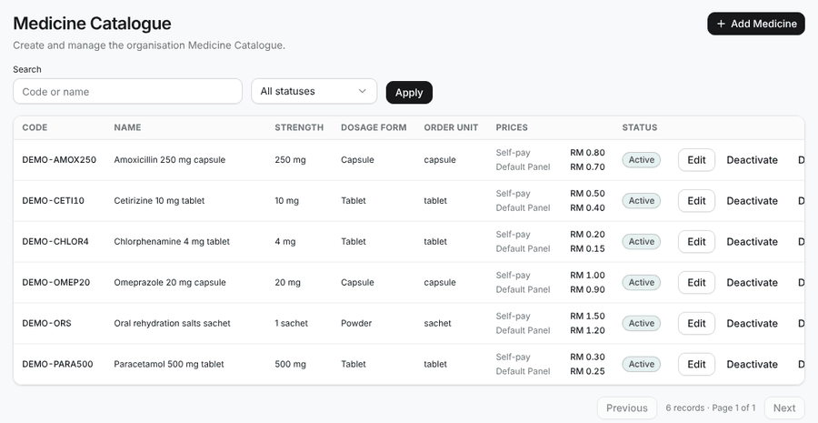
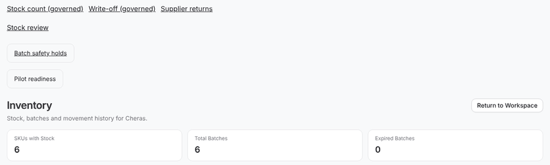
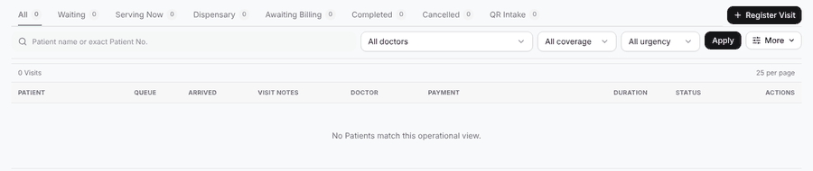
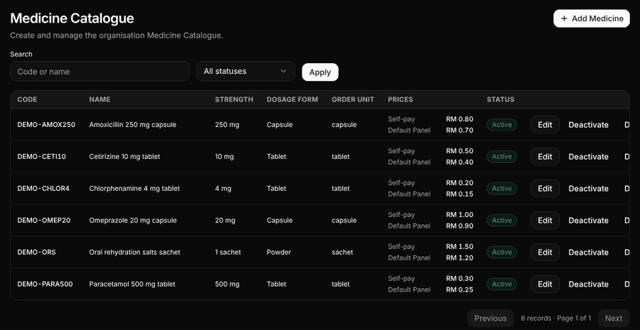
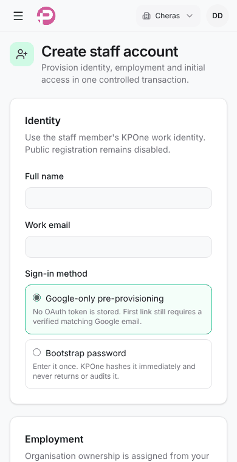
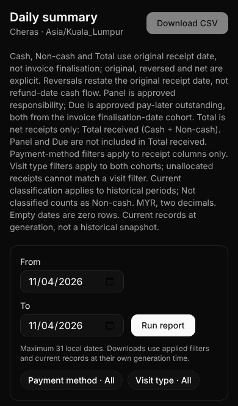
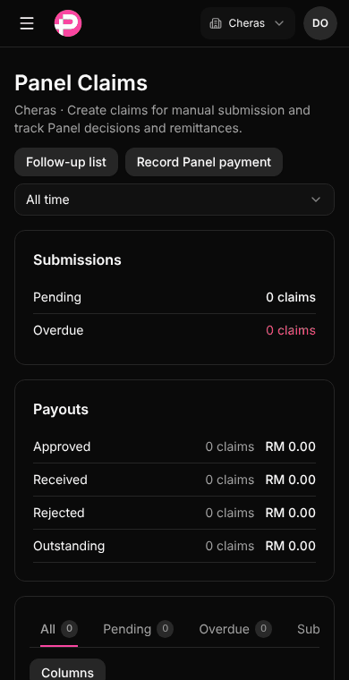
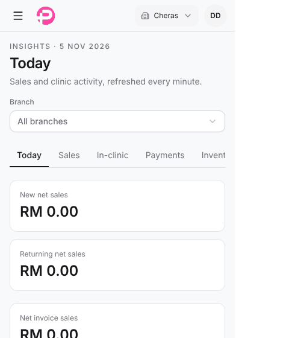

# KPOne design guide

Owner: Daniel, Lead UI/UX Designer (design team, see [TEAM.md](../teams/design/TEAM.md)).
Version 1, 2026-11-05 (DES-1). Written from a survey of 35 staff screens on `main` at `322228f`: six seeded demo
accounts (CA, Resident Doctor, CA Supervisor, Finance Officer, Panel Officer, Director), 390 and 1440 px, light
and dark, 140 screenshots, synthetic `.test` data only.

**How to use this guide.** It describes what KPOne already does well and names the patterns to stop using. It
never changes a screen by itself: the team that owns a screen fixes it in its own PR. When the guide and an
existing screen disagree, follow the guide for new work and add the old screen to the design debt list (DES-2).
Run [CHECKLIST.md](CHECKLIST.md) before every hand-off. How a screen change reaches Daniel is in [REVIEW.md](REVIEW.md); known gaps are in
[DEBT.md](DEBT.md).

**Out of scope** (owner-approved, do not restyle): the waiting-room TV (`pages/QueueDisplay/Screen.vue`), the public
website design profile, and the invoice, receipt and drug-label print layouts.

---

## 1. Colours and tokens

All colours live as CSS variables in `resources/css/app.css` (`:root` for light, `.dark` for dark) and are exposed
to Tailwind as `bg-*`, `text-*`, `border-*` utilities.

| Token | Use it for | Light | Dark |
|---|---|---|---|
| `background` / `foreground` | Page and main text | `#f8f9fa` / `#18181b` | near black / near white |
| `card` / `card-foreground` | Panels, table frames, dialogs | white | same as background |
| `muted` / `muted-foreground` | Quiet fills; help text, metadata | `#f4f4f5` / `#71717a` | grey / light grey |
| `primary` | The one main action on a screen (black in light, white in dark) | `#18181b` | near white |
| `brand` / `brand-strong` | KPOne pink: active tab, focus ring, "accent" badges | `#db2777` / `#be185d` | lighter pinks |
| `success`, `warning`, `warning-strong`, `destructive` | Status meaning only | green, amber, red | brighter versions |
| `border`, `input`, `ring` | Lines, field borders, focus ring | | |

Measured contrast on the light page background: `muted-foreground` 4.6:1, `success` 5.2:1, `warning` 4.8:1,
`destructive` 6.1:1, `brand-strong` 5.7:1, but **`brand` only 4.4:1**. In dark mode every token is above 5:1.

- **Do** use tokens: `text-muted-foreground`, `bg-card`, `border-border`, `text-destructive`. Example:
  `components/ui/status/StatusBadge.vue` maps five tones to tokens and works in both themes with no `dark:` class.
- **Don't** hard-code palette colours (`bg-amber-50`, `bg-pink-100`, `text-red-600`, `bg-white`, `slate-*`). Each one
  needs a matching `dark:` class, and forgetting it is exactly the bug DARK-1 (PR #207) fixed on four screens. Today
  about 70 pale palette backgrounds in `pages/` and `components/` sit beside only about 30 dark overrides (for
  example `pages/Dispensary/Show.vue`, `pages/Registration/Create.vue`, `components/patient-board/PatientBoard.vue`).
- **Do** use `text-brand-strong` for pink text that must be read. **Don't** use `text-brand` for small text on the
  page background (4.4:1 fails the 4.5:1 rule); `brand` is fine for lines, rings, icons and the active-tab bar.
- **Don't** add new colour tokens or fonts without the owner (TEAM.md rule). If a meaning is missing, ask Daniel.

## 2. Type

One font stack (`--font-sans` in `app.css`: Aptos, Segoe UI, system sans). No web fonts.

| Role | Classes | Example |
|---|---|---|
| Page title (one `h1`) | `text-2xl font-semibold tracking-tight` | `components/ui/page-header/PageHeader.vue` |
| Section title (`h2`) | `text-base font-semibold` or `text-sm font-semibold` | `pages/PanelClaims/Index.vue` summary cards |
| Body | `text-sm` | most pages |
| Help text, metadata | `text-xs text-muted-foreground` (`.kp-metadata`) | `components/ui/state/EmptyState.vue` |
| Table header | `text-xs font-medium text-muted-foreground`, uppercase in catalogue tables | `components/ui/table/OperationalTable.vue` |
| Money and counts | `tabular-nums`, right-aligned in tables (`.kp-tabular`) | `pages/Medicine/Index.vue` price column |

- **Do** keep 11 px (`text-[11px]`) for dense secondary lines inside boards only. **Don't** go below 11 px, and don't
  use it for anything a person must act on.
- **Don't** invent title sizes. The survey found four different `h1` styles (`text-2xl`, `text-xl` in
  `pages/Reports/*`, `text-lg` in `pages/ClinicManagement/Index.vue`, `text-[14px]`). Use `PageHeader`.

## 3. Spacing and layout

- Spacing steps: 1, 1.5, 2, 3, 4, 5, 6 (Tailwind units, 4 px each). Inside a panel use `p-4` (phone) to `p-5`/`p-6`
  (desktop); between sections `gap-4`; between a label and its field `gap-2`.
- Radius: `rounded-md` for controls, `rounded-xl` for panels and table frames, `rounded-full` for badges.
- Page frame: `mx-auto w-full px-4 py-4 md:px-5` with one maximum width per page type:
  - **work boards** (Registration, Queue, Panel Claims): full width, up to `max-w-[1600px]` (same as the header);
  - **lists and catalogues**: `max-w-7xl` (`pages/Medicine/Index.vue`);
  - **forms and detail pages**: `max-w-5xl` or `max-w-6xl` (`pages/Staff/Create.vue`).
  Today pages use four widths (5xl, 6xl, 7xl, 1600 px) with no rule; pick from the list above.
- The `.kp-page`, `.kp-section`, `.kp-control-group` classes exist in `app.css` but no page uses `.kp-page` yet. New
  pages may use them; Staff Experience owns making them the default.

## 4. Page header

- **Do** start every staff page with `PageHeader` (`components/ui/page-header/PageHeader.vue`): optional eyebrow,
  one `h1`, one short description line, actions on the right. Good example: `pages/Medicine/Index.vue`
  ("Medicine Catalogue" + "Add Medicine").
- **Do** put at most one `primary` button in the header. Secondary links go in `outline` buttons beside it.
- **Do** keep the description to one sentence. Long rules belong in a collapsible "How this works" block
  (`components/ui/collapsible`) further down. For long text inside a table cell use
  `components/ui/disclosure/DisclosureText.vue` (clamp plus tooltip on desktop, tap to expand on a phone).
- **Don't** place links or buttons *above* the page title. `pages/Inventory/Index.vue` shows five links in three
  different styles (plain underlined, underlined in a box, boxed) before the "Inventory" heading, and a second
  "Return to Workspace" button beside the global one:

  

- **Don't** ship a page without an `h1`. Registration, Queue and QR intake review (`pages/Registration/Index.vue`,
  `pages/Queue/Index.vue`, `pages/RegistrationReview/Index.vue`) have none, so a screen reader cannot tell which page
  is open (SMOKE-1 S1-009 to S1-014). A board may hide its title visually with `sr-only`, but it must exist.

  

- **Don't** repeat the global header's "Return to workspace" inside the page. When you need a back link, use one
  small `ghost` button with an arrow, as `pages/Registration/Create.vue` does ("Console"). Write it in sentence case.

## 5. Buttons

Variants in `components/ui/button/index.ts`: `primary` (default), `outline`, `secondary`, `ghost`, `accent`,
`destructive`, `link`. Sizes `sm` (32 px), `default` (36 px), `lg` (40 px), `icon` (36 px).

- **Do** one `primary` per area (the next step), `outline` for the others, `destructive` only for actions that
  void, remove, reverse or cancel.
- **Do** show progress in the button: spinner plus a "…ing" label while busy, as `OperationalConfirmDialog.vue` does.
- **Don't** put three or more text buttons in a table row. `pages/Medicine/Index.vue` rows show Edit, Deactivate and
  a third action that is cut off at 1440 px. Use one visible action plus a row menu (`...`), as
  `components/patient-board/PatientBoard.vue` does.
- **Don't** use `accent` (pink fill) for ordinary saves; keep pink for selection and emphasis.

## 6. Tables and their phone layout

Use `components/ui/table/OperationalTable.vue` for every data table: it gives a labelled, keyboard-focusable
scroll region, a hidden `<caption>`, a loading row, an empty row and consistent cell padding.

- **Do** right-align money and counts with `tabular-nums`; keep the status column as a `StatusBadge`.
- **Do** give every table a phone layout below 768 px. KPOne has three good patterns; use the one that fits:
  1. **Row becomes a card** with each cell labelled by `data-label`: `components/patient-board/PatientBoard.vue`
     (scoped CSS at the bottom of the file). Best for boards.
  2. **Separate card list** shown with `md:hidden` while the table is `hidden md:block`:
     `components/registration/QrIntakeTable.vue`, `pages/PanelRemittances/Index.vue`.
  3. **Short list** with `sm:hidden` for a few rows: payments list in `components/billing/BillingWorkspace.vue`.
- **Don't** rely on sideways scrolling as the phone layout for a list people work from. On a 390 px phone the
  Medicine Catalogue shows only Code and Name and hides prices, status and actions off screen. Sideways scroll
  inside the table frame is acceptable only for wide reference tables nobody edits on a phone.
- **Don't** write raw `<table>` markup for new screens. The survey found 28 raw tables against 11 `OperationalTable`
  uses.
- Pagination: `components/ui/pagination/CompactPagination.vue` ("Previous · 6 records · Page 1 of 1 · Next").

## 7. Forms and errors

- **Do** stack the label above the field, connect them (`<Label for="x">` and `id="x"`), and put the error right under
  the field with `components/InputError.vue`. Good example: `pages/Staff/Create.vue` (fixed in UI-POLISH-1).
- **Do** group fields in titled panels (Identity, Employment, Roles) and put the primary Save at the end of the form
  and, for long forms, also in the header.
- **Do** mark required fields with `*` in the label and say what format is expected in help text under the field
  ("12 digits, no dashes").
- **Do** set `aria-invalid="true"` on a field with an error; the input styles turn the border red automatically
  (`components/ui/input/Input.vue`).
- **Don't** leave fields without a label. The survey found 10 of 13 fields unlabelled on `pages/Pricing/Index.vue`
  and 7 of 23 on `pages/PanelSettings/Form.vue`; a placeholder is not a label.
- **Don't** use placeholder text as the only instruction; it disappears when the person types.
- **Don't** write server-validation messages in internal language. Say what to do: "Enter the 12-digit SSM number."
- Error colour: `InputError.vue` uses `text-red-600 dark:text-red-500`. New code should use `text-destructive`
  (same look, one token). Staff Experience may switch the component.

## 8. Dialogs and confirmations

- **Do** use `components/ui/OperationalConfirmDialog.vue` for every "are you sure" step. It focuses the confirm
  button, blocks closing while busy, shows a spinner label and an inline error, and supports a third choice
  ("Save and hold / Discard and hold / Cancel", OH-06c).
- **Do** write the title as the action ("Void this invoice?") and the description as the consequence in one or two
  sentences. Use `destructive` for irreversible actions.
- **Don't** use the browser's `confirm()`. `pages/Patient/Show.vue` (retire identifier) still does; it cannot be
  styled, is not themed in dark mode and ignores the KPOne focus rules.
- Long tasks (edit a record, choose a batch) go in a `Dialog` or `Sheet` (`components/ui/dialog`, `components/ui/sheet`)
  with a clear title, the form, and Save / Cancel at the bottom right.

## 9. Toasts

- **Do** confirm a finished action with a short toast. The server sends it with
  `Inertia::flash('toast', ['type' => 'success', 'message' => ...])` (see `app/Http/Controllers/QueueController.php`)
  and `resources/js/lib/flashToast.ts` shows it through `components/ui/sonner/Sonner.vue`.
- **Do** write it as a past-tense fact: "Patient called again on the TV."
- **Don't** use a toast for an error the person must fix; show the error on the page next to the cause.
- **Do** show staff toasts at the top, centred, just under the 52 px sticky header (64 px from the top), at every
  width, desktop included (owner decision 2026-11-05, Staff Experience PR #241, UX-1). The placement lives in
  `resources/js/lib/toastPlacement.ts`, used by `ClinicLayout` and `AdminLayout`; don't set a position per page.
- **One exception (owner decision 2026-11-05, Staff Experience PR #277, UX-5):** the consultation page in focus mode,
  from 1024 px wide, shows toasts at the bottom left, at most 20 rem wide
  (`resources/js/lib/focusToastPlacement.ts`). The page has no staff header and keeps its own toolbar pinned at the
  top, so a top toast covered Panggil semula and the waiting count. **Don't** copy this to another page: ask the
  Lead UI/UX Designer first.
- **Don't** let a toast sit on a page's sticky action bar (SMOKE-1 S1-015: a toast covered Complete Consultation at
  390 px). **Don't** pin a new sticky bar at `top-16` (64 px): that is where toasts appear (the Quick create bar
  clashes today).

## 10. Status badges

- **Do** use `components/ui/status/StatusBadge.vue` with a status key; tones and labels come from
  `resources/js/lib/presentation.ts` (Waiting = warning, Serving = accent, Completed = success, Void = danger).
- **Do** add a new status to `presentation.ts` instead of styling a one-off badge.
- **Don't** hand-build badges with palette colours (`bg-rose-100/70 text-rose-700`, `bg-pink-100/70` in
  `PatientBoard.vue`, `statusClass` in `QrIntakeTable.vue`). They look slightly different on every page and need
  separate dark styles.
- Use `components/ui/badge` (`Badge`) only for neutral labels and counts (tab counters), not for status meaning.
- Never rely on colour alone: the badge always carries a word.

## 11. Empty, loading and error states

- **Empty:** `components/ui/state/EmptyState.vue` (dashed panel, title, one line of help, optional action). Say what
  is missing and what to do: "No visits yet today. Register a visit to start." **Don't** write "No Patients match
  this operational view." (`PatientBoard.vue`): it is jargon and capitalises a common noun.
- **Loading:** `components/ui/state/LoadingState.vue` (spinner or skeleton rows, with `role="status"`). It exists but
  no page uses it yet; prefer it over ad-hoc "Loading…" text. Tables use the loading row in `OperationalTable`.
- **Error:** `components/ui/state/ErrorState.vue` (`role="alert"`), and for live boards keep the last good rows with a
  calm notice, as REG-LIVE-1 does in `pages/Registration/Index.vue` ("Live refresh paused. Showing last successful
  results.").
- **Refused (403) pages:** keep the standalone 403 page; do not show a link to a page the person cannot open
  (SMOKE-1 S1-005).

## 12. Focus and accessible names

- **Do** keep the built-in focus ring: `focus-visible:ring-[3px] focus-visible:ring-ring/40` on buttons and inputs,
  `focus-visible:ring-2 focus-visible:ring-ring` on custom links (see `components/workspace/WorkspaceHeader.vue`).
- **Do** give every icon-only button an `aria-label` ("Open navigation", "Open user menu" in `WorkspaceHeader.vue`).
  The survey found one unnamed button on `pages/PaymentMethods/Index.vue`.
- **Do** give every page exactly one `h1`, sections `h2`, and tables a label (OperationalTable does this).
- **Do** mark the current item with `aria-current="page"` in navigation and tabs.
- **Do** make touch targets at least 44 by 44 px on phone screens for row actions (PatientBoard uses `min-h-11
  min-w-11`). Small `sm` buttons are fine on desktop toolbars.
- **Do** close the mobile navigation drawer when a link in it is chosen (SMOKE-1 S1-017). The Sheet in
  `WorkspaceHeader.vue` is controlled (`v-model:open`) and closes on link click. **Don't** close it on every Inertia
  navigate event: live boards refresh themselves and would snap it shut (UX-1, PR #241).

## 13. Dark mode

Every screen must work in light and dark. The theme comes from Settings > Appearance (stored in the browser and a
cookie); `.dark` on `<html>` switches the tokens.

- **Do** use tokens and nothing else; then dark mode is free.
- **Do** check native controls in dark mode. Date and time pickers (`pages/Reports/*`, `pages/PanelInvoices/Index.vue`)
  show a dark calendar icon on a dark field because the app does not set `color-scheme: dark`. Staff Experience owns
  this one-line shell fix.

  

- **Don't** use `dark:bg-slate-900` and similar one-off dark colours (`OperationalConfirmDialog.vue` does). Use
  `bg-card` or `bg-popover`.

## 14. Print

- Print views (`pages/Billing/Print.vue`, `pages/Dispensary/Labels.vue`) use the `.document-print` and
  `.label-preview` classes. `app.css` forces white paper and black text in every theme (PRINT-1). Keep it.
- **Do** hide screen-only controls with `print:hidden` (toolbar, help notes).
- **Don't** change the invoice, receipt or label layout without the owner and, for labels, the pharmacist.
- **Prints follow their own rules, not the screen rules.** Where the owner gave a sample, the sample wins.
  Recorded exceptions (owner and B.E.R.N.I.S.S for the owner, 2026-11-06):
  - **Dates:** the Medical Certificate and the drug label print `dd/mm/yyyy`; the invoice and receipt print
    `30 Oct 2026`, as on screen.
  - **Phones:** every letterhead prints phones through the shared `PrintedPhone` formatter, local form, one
    "Tel:" label, a second phone after " / " (`Tel: 03-2123 4567 / 012-345 6789`). A line may wrap only after the
    " / ", never inside a number.
  - **A4 margins:** 15 to 20 mm set in `@page`. Check a print with real PDF page images, not a screen shot of the
    print view.
  - **Page numbers:** a multi-page document prints its number and "Page n of N" on every page
    (`KPI-00000002 · Page 1 of 2`); a single page prints none.

## 15. Wording

- **Language:** staff screens are English unless the screen's rule says Bahasa Melayu. Registration and Patient
  screens are English (owner, 2026-11-05); "Panggil semula" stays. Patient-facing QR pages are Bahasa Melayu except
  the REG-2 messages. Drug-label headings are Bahasa Melayu. Never mix both languages in one sentence.
- **Sentence case** for titles, buttons and labels: "Register visit", "Return to workspace". Proper nouns keep
  their capitals (Panel, KPOne, CA). The survey found "Return to Workspace" and "Return to workspace" side by side.
- **Buttons are verbs**: "Save prices", "Run report", "Add panel". Not "OK" or "Submit".
- **Plain English, short sentences.** Explain the result, not the system: "Shows receipts by the day they were
  paid." instead of "original receipt date, not invoice finalisation". Keep internal words out of the UI
  ("canonical", "operational view", "cohort", "projection", "provisioning", "authoritative").
- **Numbers:** money as `RM 0.00` (two decimals, space after RM), dates as `5 Nov 2026` on screens and in the branch
  time zone, with times as `5:04 PM`. Prints have their own date and phone rules (section 14).
- **Long rules** (the Daily summary page shows about 15 lines before the form on a phone; the text comes from
  `app/Domain/Shared/Services/DailySummaryReportService.php` and is shown by `pages/Reports/BranchReport.vue`):
  one summary sentence on screen, the rest in a collapsible "How this report counts" block.

## 16. Phone rules (320, 390, 768 px)

- **No sideways page scroll at 320, 390 or 768 px.** The page width must equal the screen width. Survey failures:
  `pages/Insights/Today.vue` is 490 px wide at 390 px (ranking cards, SMOKE-1 S1-004) and `pages/Patient/Create.vue`
  is 433 px wide at 390 px (a field grid).

  

- **Do** stack columns below 768 px: `grid gap-4 md:grid-cols-2`, never a fixed `grid-cols-2` on a form.
- **Tables inside cards on phones** (UX-1, PR #241):
  - **Do** put `min-w-0` on the grid item that holds the card, and set a minimum table width only from `sm` up
    (`sm:min-w-[...]`), never a bare `min-w-[...]`.
  - **Do** on phones let the name column truncate with a `title` tooltip, or wrap with
    `max-sm:[overflow-wrap:anywhere]`.
  - A table of five or more columns may scroll sideways *inside its card*. **Don't** let it make the page scroll.
- **Do** add `min-w-0` to grid and flex children that hold long text, and `truncate` or `break-words` on the text
  (the QR status fix in PR #52 and the Registration result fix in REG-1).
- **Do** let filter rows wrap (`flex flex-wrap gap-2`) and make the Apply button full width on phones if it sits
  alone, as on `pages/Queue/Index.vue`.
- **Do** keep tabs scrollable in one row (`overflow-x-auto`) with the active tab visible; never let tabs push the
  page wider.
- **Do** check the header: the top bar collapses to the menu button and logo below `xl`
  (`WorkspaceHeader.vue`).

## 17. Icons

- Icons come from `@lucide/vue` only. Size `size-4` in buttons and text, `size-5` in the header.
- Decorative icons get `aria-hidden="true"`; an icon that is the only content of a button needs the button's
  `aria-label`.
- The coloured square icon next to a page title (Staff, Patients) is optional; if used, use a token fill
  (`bg-success/10 text-success`), not `bg-emerald-50`.

## 18. Department spaces (version 2 direction)

Owner-approved direction, 2026-11-11 ("agree map"): KPOne is organised as department **spaces** instead of one long
menu. The clickable sketch (synthetic data, builds nothing) is the visual reference:
<https://claude.ai/artifact/6SGv7ub1FTF2gDgfB6SY39>. The Staff Experience team builds it, plan first, and Daniel
reviews every screen ([REVIEW.md](REVIEW.md)). This section is the direction for that work. It does not change a
screen by itself, and it does not widen anyone's access: a space shows only what the person's existing permissions
already allow, and the backend still decides.

**Spaces and who sees them (owner decision, 2026-11-11):**

| Role | Spaces |
|---|---|
| CA | Front desk, Pharmacy, Billing |
| CA Supervisor | the same plus Stock |
| Resident Doctor | Consultation |
| Panel Officer | Panel |
| Finance Officer | Billing, Panel, Stock |
| HR Manager | HR |
| Administrator | Stock (setup only), Management (settings only) |
| Technical Admin | Management (staff and access only) |
| Director | all eight |
| Marketing, Business Development | none of the eight |
| TV account | the TV only |
| Everyone (not the TV) | **Me**, in the account menu (not the sidebar): own roster, leave, attendance, claims, credentials, SOPs, payslips |

The eight spaces are Front desk, Consultation, Pharmacy, Billing, Panel, Stock, HR and Management. A space a person
cannot open is **absent from the sidebar**, never greyed out. Server-side permission and branch checks stay the
only authority (frontend visibility is a usability aid, as in `AGENTS.md`).

**Layout**

- **Do** use the shell from the sketch: a grouped sidebar (Clinic, Money, Back office, Oversight; no Me, see below), a top
  bar with a search or command bar, the branch switcher and the account button, and one page body.
- **Do** keep one `h1` per space through `PageHeader` (name, one line of description, actions at the right), then a
  segmented control for the space's tabs, then the work table, then the side panels.
- **Do** put **Recent activity as a strip along the bottom** of the page, full width, not in a side column. It lists
  only activity the person may already see in that space; Management shows all teams.
- **Do** keep the main column for live work (table with timers) and the side column for "Needs attention" and
  "Waiting for a second person". Below 720 px (container) the layout is one column and the table becomes cards
  (section 6); the sidebar becomes a full-height sheet opened from the menu button.
- **Do** show a count beside a space in the sidebar only for work waiting for **this person** (approvals, items to
  act on), never a vanity total.

**Work tables and timers**

- **Do** show waiting as a ring plus words: amber from 30 minutes and red from 60 (the Q-1 rule, fixed for every
  branch), with "long" or "very long" in the text. Colour is never the only signal (section 10).
- **Do** use a status chip that carries a word and a dot (`StatusBadge` tokens), in the same order and wording on
  the table, the card and the side panels.
- **Don't** invent new timer rules per space. Use the same two thresholds, or show an age in days or hours as plain
  text where a patient is not waiting.

**Two-person approvals** (stock counts, write-offs, refunds, Panel payment reversals, leave, overtime, returns)

- **Do** show who recorded it and who is still needed as an **avatar stack**: the recorder's initials, then a dashed
  empty circle for the missing second person, filled once someone approves. The stack always has a text equivalent
  ("Recorded by Siti Hajar. Needs a second person.") and an accessible name.
- **Do** keep a refused action visible: if the viewer recorded the item, the Approve button is replaced by a
  disabled-style note that says why ("You recorded this, so you cannot approve it. Ask a Finance Officer or
  Director.", section 11). The server still refuses it.
- **Do** put the Approve action in the card where the evidence is, never only in Management.
- **Management** is an overview: it lists every team's waiting approvals and alerts, and each row opens the owning
  space. It never becomes a second place to decide, unless the item's own permission is held there.

**Alerts**

- **Do** write every alert in three parts: **what** (title), **why** (one plain line) and **next step** (a button
  that goes to the fix). No alert without a next step.
- **Don't** use alerts for marketing, tips or "welcome" messages.

**Look (Apple-like, calm, not decorative)**

- **Do** use the system font stack (`-apple-system`, "SF Pro", Inter as fallback), a restrained type scale
  (28 to 30 px page title, 15 px panel title, 14 px body), tabular figures for numbers and times, and generous
  line height.
- **Do** use solid token surfaces with a 0.5 to 1 px hairline, 10 to 14 px corners (consistent, not bubbly),
  and very soft layering. Dark mode uses the bluish greys in section 19 (page `#12141a`, surface `#1c1f27`); this
  replaces the earlier "neutral grey, not navy" line (owner decision 2026-11-12).
- **Do** use one cobalt accent for selection, links and primary buttons. KPOne **pink stays for the logo mark, the avatar and
  small accents only** (section 19);
  it is not an interface colour in the spaces. (The existing pink tokens elsewhere are unchanged until Daniel and
  Kavitha agree a migration.)
- **Do** use a segmented control for tabs and small filters, and Lucide icons only (section 17).
- **Do** keep motion small and spring-like on hover and press, and switch it off under
  `prefers-reduced-motion`.
- **Don't** use purple-to-blue gradients, glow, glassmorphism or blur, sparkle or emoji icons, a "Welcome back!"
  hero, giant rounded shadowed cards, or a stock-SaaS look.

**Me** (decision 2026-11-12, owner: more private and professional in the account menu; built as DS-12)

- **Do** put **Me** inside the **account menu** (the avatar at the top right), as the first group under the person's
  name: My profile, My roster, My leave, My attendance, My claims, My credentials, My SOPs, then Security and
  Sign out. Everyone except the TV account has it. It shows only that person's own records, never other people's, and
  is not a place to approve anything.
- **Don't** show Me or a "You" heading in the sidebar or the phone space strip. This also frees a slot in the 390 px
  strip.
- **Do** keep one **Clock in** shortcut for staff who may clock in (`hr.attendance.clock.own`): a small outline
  button in the top bar beside the branch switcher from 1024 px, and a row at the top of the account menu below it.
  It shows "Clock in" or "Clock out" from the same state as My attendance, never a second source. It asks to confirm
  Clock out, as My attendance does, and the server's 60-second and branch rules still apply. The button is 44 px
  below 1024 px. Daily actions must not sit two taps deep.
- **Do** show the person's name beside the avatar from 1024 px, and the avatar alone below it.

**Me home (page `/me`)** (decision 2026-11-12, owner: "A + B tiles", with B's gradient adjusted to suit A). Board: "Me and Clock-in Chosen" (design canvas), phone 390 px and desktop 1440 px, light and dark, both states.

- **Do** build it in this order: greeting ("Good morning, Aina", or "Have a good shift, Aina" once clocked in) with date and branch; the live time (52 px phone, 58 px desktop); the **ring**: a round cobalt Clock in button (192 px phone, 224 px desktop, camera icon and the word) inside a track ring; a status chip in words ("Not clocked in" with "Your shift 9:00 AM to 6:00 PM", or "Clocked in 8:58 AM, on time"); the **This week** card (Mon to Fri dots, each with a tick, "!" or dash and the day name, plus "3 on time, 1 late"); then **four tiles**: My leave, My claims, My roster, My attendance; then the "About clock-in photos" link (44 px).
- **Do** swap the button for the same-size ring showing "Worked 3h 12m" and "36% of your shift" once clocked in, with the ring filled in green, and put "Start break" and "Clock out" (pink outline) in one row below it. Clock out still asks to confirm. Break and the 60-second and branch rules follow My attendance.
- **Do** put the soft gradient behind the top of the page only: light is peach `#ffdcc2` to sky `#cfe2ff`, dark is dusk plum `#5a3550` to navy `#1c2a4a`; both fade into the page colour before the tiles. Use `--g1` and `--g2` tokens and a 180deg fade on desktop, 165deg on a phone. The greeting, time and muted lines must keep 4.5:1 on the gradient, so the muted colour is `#4a5468` in light and `#b0b8cc` in dark, and the status chip and week card sit on solid surfaces.
- **Do** colour the tiles with the soft tint tokens (`--t1` to `--t4`: blue, pink, green, amber), each with an icon tile and its name in words, 84 px tall or more; in dark mode they are deep tints, not pale fills.
- **Don't** put the gradient behind tables, forms or cards. It belongs to Me only. Pink stays the logo mark and small accents; the cobalt button is the one main action.
- On desktop the top-bar Clock in shortcut is not shown on this page, because the ring is the button.

**Photo clock-in** (decision 2026-11-12, owner chose option 2, "Camera app")

- **Do** open a full-screen camera on a phone and a large dialog on desktop. The camera screen is always dark, in light and dark mode, with a close button at the top left (44 px, named "Close") and a switch-camera button at the top right.
- **Do** show one oval face guide and the line "Centre your face in the oval". The shutter is one big round button at the bottom centre, at least 72 px, named "Take photo". No gallery picker: a live photo only.
- **Do** end the review screen with two pills at the bottom: "Retake" (quiet) and "Use photo" (cobalt, the main one). KPOne records the time when "Use photo" is pressed, and the screen says so.
- **Do** confirm with a full-screen success screen: "Clocked in" or "Clocked out", the time and branch, a chip in words ("On time", "Late 12 min", "No shift set"), and a Done button.
- **Do** show the same wording on every failure: "KPOne needs your camera to clock in. Allow the camera, or ask HR to add your time as a correction." There is no way to clock in without a photo.
- **Do** show the full photo notice once, as a bottom sheet titled "About clock-in photos" before the first camera opens, with one button, "OK, open the camera". It says a live photo is taken, only HR can open it and each look is recorded, photos are kept 7 years, and the person can always see their own. Keep the same wording as a line at the bottom of My attendance and on the privacy page. **Don't** repeat "HR can see it" or "kept 7 years" on the Me home or under the Clock in button (owner decision 2026-11-12).
- **Do** hide other people's photos, thumbnails included, behind an audited Show, as with bank details. A person's own photos show directly. An entry added by correction says "No photo (added by correction)".
- **Don't** colour the chips only: each carries its word and a dot (section 10). Honour `prefers-reduced-motion` for any shutter or countdown animation.

**Accessibility and phone (sections 12 and 16 still apply)**

- Each space has a `main` landmark, a skip link and one `h1`. The sidebar is a `nav` with an accessible name, the
  current space has `aria-current="page"`, and the segmented control is a real tab list.
- Below 1024 px every target is at least 44 px tall. The phone sidebar opens from a 44 px menu button and closes
  after a space is chosen.
- A role sees at most the spaces in the table above; a CA sees three. Me is in the account menu for everyone but the TV. Check the sidebar for each
  role at 390 and 1440 px, in light and dark, before hand-off.

**Open for the plan** (Kavitha's team decides with Daniel before building): how existing pages map into spaces and
what stays reachable by direct link; whether the top bar keeps any current items; the command bar's scope (jump to
spaces and recent patients only, no clinical search); and the dark-mode neutral greys and cobalt values as tokens.

---

## 19. The app-wide look (decision 2026-11-12)

Owner decision: the Apple-like style chosen for the department spaces (option 1's look with option 4's layout, Recent
activity as a strip at the bottom) is the style of the **whole app**, not only the spaces. It applies to the main
working pages (Registration, Consultation, Dispensary, Billing, Inventory, Reports, Settings and the rest) as well as
the spaces. The five alternative Front desk samples are retired and nothing is built from them. This section is the
standard; where it differs from sections 1 to 17, this section wins for new and restyled screens. It is a look, not
behaviour: a restyle never changes a permission, route, payload, validation or rule. Order and ownership of the
restyle: [RESTYLE.md](RESTYLE.md). Print views, the TV screen and the public QR pages are not restyled (see the end).

**Tokens** (the values below are the targets for `resources/js` tokens; Staff Experience migrates `app.css` once, so
pages inherit them and no page sets its own colour)

| Token | Light | Dark | Use |
|---|---|---|---|
| `background` | `#f4f6fb` | `#12141a` | Page |
| `card` (surface) | `#ffffff` | `#1c1f27` | Cards, tables, dialogs, sheets |
| `muted` (surface 2) | `#eaeef7` | `#262a35` | Quiet fills, segmented-control track, hover |
| `foreground` | `#161a24` | `#f3f5fa` | Text |
| `muted-foreground` | `#4a5468` | `#b0b8cc` | Help, metadata (4.5:1 or better on the page and on the gradient) |
| `border` | `#d5dbe9` | `#323747` | Hairlines (1 px) |
| `primary` / `ring` (cobalt) | `#0a56d1` | `#6ba6ff` | The one main action, selection, links, focus ring. Text on it: white in light, `#0b1a33` in dark |
| `brand` (pink) | `#e8337f` mark; `brand-strong` `#c4155f` | `#ff86ae` | The KPOne logo mark, the avatar and small accents only. Not a button, tab or focus colour |
| `success`, `warning`, `destructive` | `#0b6b34`, `#7d4400`, `#b3261e` on soft fills `#e1f3e8`, `#fcefd0`, `#fde8e6` | `#6fdc9a`, `#f2bf68`, `#ff8a80` on deep fills `#12301f`, `#3a2a0a`, `#3c1a18` | Status meaning only, always with a word |
| tints `t1` to `t4` | blue `#e0ebff`, pink `#fde3ee`, green `#e1f3e8`, amber `#fcefd0` | `#1e2c4a`, `#3c2030`, `#12301f`, `#3a2a0a` | Shortcut tiles and soft icon tiles only |
| `g1`, `g2` (Me gradient) | `#ffdcc2`, `#cfe2ff` | `#5a3550`, `#1c2a4a` | Behind the top of the Me home only |

- **Do** change a colour in one place (the token). **Don't** write a hex, a palette class (`bg-slate-*`, `bg-amber-50`)
  or a `dark:` colour in a page: section 1 and section 13 still apply.

**Type** (system font stack, tabular figures for money, times and counts)

| Role | Size and weight |
|---|---|
| Page title (`h1`, `PageHeader`) | 28 px (30 from 1024 px), 700, tight tracking |
| Section title (`h2`) | 20 px, 650 |
| Card title | 16 to 17 px, 650 |
| Body, table cell, field | 15 px (14 px in dense tables), 400 |
| Help, caption, chip | 13 px, 500 to 600 |
| Big number (stat, time) | 40 to 58 px, 700 |

**Shape and surfaces**

- **Do** use solid surfaces with a 1 px hairline: 10 px corners for fields, buttons and chips-in-rows, 14 px for cards
  and tables, 18 to 20 px for the hero card and tiles, a full pill for chips and segmented tabs. Shadows only on
  floating things (menus, dialogs, the Clock in ring button), soft and low.
- **Don't** stack shadowed cards inside cards. A card holds rows, not other cards. Group with a hairline and spacing.

**Values to build with** (Wave 0.1 uses exactly these; a page never invents its own)

| Thing | Value |
|---|---|
| Radius: list item, menu item | 8 px |
| Radius: buttons, fields, selects, chips in rows | 10 px (one value for all controls; if the spaces sketch used 9 px, use 10) |
| Radius: cards, tables, side panels | 14 px |
| Radius: hero card, tiles, dialogs, bottom sheets | 18 px (20 px for the Me hero) |
| Radius: chips, segmented control, avatar | full pill or circle |
| Shadow: cards, tables, buttons, fields | none (a 1 px hairline only) |
| Shadow: menus and popovers | `0 8px 24px rgba(16,24,40,.12)` plus the hairline |
| Shadow: dialogs and sheets | `0 16px 48px rgba(16,24,40,.18)` plus the hairline |
| Shadow: Clock in ring button only | `0 12px 28px rgba(10,86,209,.32)` |
| Shadow in dark mode | `rgba(0,0,0,.5)` at the same sizes; the hairline does most of the work |
| Type, page title | 28 px / 34 (30 px / 36 from 1024 px), weight 700, tracking -0.01em |
| Type, section title | 20 px / 26, 650 |
| Type, card title | 16 to 17 px / 22, 650 |
| Type, body and fields | 15 px / 22 (14 px / 20 in dense tables), 400 |
| Type, help, caption, chip | 13 px / 18, 500 to 600 |
| Type, big number | 40 to 58 px / 1.05, 700, tabular figures |
| Spacing | 4 px grid: 8 inside rows, 16 inside cards, 24 between cards, 32 around the page on desktop, 16 on a phone |

**Buttons** (section 5 order and wording still apply)

- **Do** keep **one cobalt button per screen or dialog** at the level of the whole page. **Don't** make a per-row action
  cobalt: a row action is an outline button or a "..." menu, because a table of 25 rows would have 25 primaries.
  When a page has bulk actions, the page shows no cobalt button until rows are ticked; then a selection bar appears
  with the **one** bulk action in cobalt and the others outline. A page with no single obvious main action may have no
  cobalt button at all.
- **Do** use cobalt for the one main action, an outline button for everything else, a quiet text button for the lowest
  level, and a red button only for a destructive confirm. 44 px tall below 1024 px, 36 px from 1024 px, 10 px
  corners, the label in words. Pink buttons are retired.

**Links**

- **Do** colour every text link cobalt (`text-primary`, 4.5:1 or better on the page and on cards) with a 44 px hit area
  below 1024 px. A link inside a sentence or paragraph is **underlined**, so it never depends on colour alone.
- **Do** use a link on its own line (a "View all ..." or "Open the approval inbox" link, a back link) **without an
  underline**, with a non-colour cue instead: a trailing chevron or arrow icon (a back link has a leading arrow), and an
  underline on hover and focus. A back link may stay the normal text colour with its arrow; it is navigation, not an
  inline link, so the tests that pin "no underline" on the Billing and Finance back links stay valid.
- **Don't** make a link look like plain text (the Billing "View all bills to collect" line today), or use pink for a link.
- **Don't** use a link for an action that changes data; that is a button.

**Chips and badges**

- **Do** keep `StatusBadge`: a pill with a dot and a word, tone from the tokens (neutral, success, warning,
  destructive, info in cobalt tint). Same wording and order on the table, the card and the side panel (section 10).

**Tabs and filters**

- **Do** use the segmented control for tabs with up to five items and for small filters: a `muted` track, the selected
  segment a `card` pill with cobalt text, 44 px below 1024 px, scrolling with a fade on a phone. A count sits in the
  label in words ("Waiting 2"). Track and selected segment are both a full pill (decided 2026-11-12, 0.4). **Don't** use the pink underline tab any more on restyled pages. A board with more than five tabs (Registration has eight) may scroll with the fade, as a deliberate exception; the selected tab scrolls into view.

**Lists and tables** (section 6 still applies)

- **Do** keep tables on `OperationalTable`: 1 px hairline frame at 14 px corners, a `muted` header row with 13 px
  labels, 52 px rows (44 px minimum), right-aligned numbers in tabular figures, a hairline between rows, and a hover
  tint that is not the selection colour. Below 1024 px the same rows become cards (one card per row, label and value
  pairs, the action as a 44 px button).
- **Do** use a plain list row (title, one muted line, a trailing chip or chevron, 56 px) for short lists in side panels
  and for Recent activity.

**Dialogs, sheets and menus** (section 8 still applies)

- **Do** use a `card` surface, 18 px corners, a soft shadow, a 44 px close button named "Close", the title in
  sentence case and the main action as the right-hand button. On a phone a dialog becomes a bottom sheet with a grab
  bar when it holds a form. Destructive questions use the shared confirm with the destructive tile.

**Forms** (section 7 still applies)

- **Do** use 44 px fields (36 px from 1024 px in dense settings), 10 px corners, the label above, help and errors
  below in words, a cobalt focus ring. **Don't** hide the label in a placeholder.

**The page frame**

- **Do** give every page the same frame: `PageHeader` (title, one line, actions at the right), then tabs, then the
  work, with the **Recent activity strip at the bottom** where the page has activity to show. Keep content width to
  1280 px centred from 1440 px so a title is never stranded at the far left of a wide screen.
- **Exception (approved 2026-11-12):** the Consultation queue board keeps a 1600 px maximum width, because it is a
  live 12-column board. Its header is a visible `PageHeader` titled "Consultation queue" with no description line.
  Do not copy this width to other pages without asking the Lead UI/UX Designer.
- **Form pages (approved 2026-11-12):** a page that is mainly a settings form (Business details is the first) may
  use a centred `max-w-4xl` column instead of 1280 px, because two-column forms read badly when very wide. The
  header, cards and footer buttons follow the normal frame. Tables and boards do not get this width.
- **Breakpoints (found in D4b, 2026-11-12):** in Tailwind v4 an arbitrary px breakpoint such as `min-[1440px]:` is
  written into the CSS before `lg:`, so `lg:` wins at 1440. Write custom breakpoints in rem (`min-[90rem]:`) so they
  sort with the built-in ones. Dispensary's layout is the example: two columns from 1024 to 1439, three from 1440.
- **Reading order over visual order (D4b, 2026-11-12):** on pages where a two-column layout draws a side panel on the
  other side of the lines, keep the DOM in safety order (patient, allergies, then the lines, then the actions) and say
  so in a comment next to the grid. Do not make a side column sticky if it can be taller than the screen, and never
  make a completing action sticky above content the person must read first.
- **Do** use the gradient only on the Me home (section 18). Working pages stay on the plain page colour.

**Motion and icons**

- Small, spring-like hover and press (under 200 ms), off under `prefers-reduced-motion`. Lucide icons only, 20 px in
  tiles and 16 px in buttons, never the only signal.

**Not restyled (stay as they are)**

- Printed documents and labels (white, layout unchanged, section 14), the waiting-room TV
  screen (its own look), the sign-in screens, and the public QR pages (own brand styling). They
  inherit new tokens only if the owner and Daniel agree for that screen.

**Restyle checklist (one list for every team; the spaces sketch is the reference:
<https://claude.ai/artifact/6SGv7ub1FTF2gDgfB6SY39>, and the Me home board "Me and Clock-in Chosen")**

Page anatomy, top to bottom. Tick each before you send shots.

1. **Frame:** `PageHeader` with one `h1` (name), one muted line, and the actions at the right. Content centred at 1280 px
   from 1440 px. Back link above the title only where the page is a child page.
2. **One primary action:** exactly one cobalt button on the page (or per dialog). Everything else is outline or quiet.
   It sits in the header's action area, or at the right of the toolbar above the work, never both.
3. **Tabs and filters:** one segmented control for the tabs (up to five), then one filter row. Counts in the label.
4. **Cards:** a 14 px card holds one idea: a title, then rows. Stat cards show a muted label, a big number and one muted
   line. No card inside a card, no coloured fill except the tint tiles on the Me home.
5. **Lists and tables:** `OperationalTable` from 1024 px, one card per row below it, numbers right-aligned, the row's
   action as a 44 px button or a "..." menu named for the row. Short lists in side panels are plain list rows.
6. **Side panels:** "Needs attention" and "Waiting for a second person" in the right column, one list row each with its
   chip and a next-step button.
7. **Recent activity strip:** full width at the very bottom, only where the page has activity the person may see.
8. **Forms:** label above, 44 px field, help and error below in words, required marked, one Save at the right and a
   Cancel beside it. Sections separated by a hairline and a 16 px section title.
9. **Dialogs:** `card` surface, title in sentence case, one cobalt action at the right, Cancel beside it, close button
   named "Close". A form dialog is a bottom sheet on a phone. A destructive question uses the shared confirm.
10. **Empty, loading and error states:** an empty list says what is missing and the next step in one muted sentence with
    a button ("No purchase requests yet. Press New request."); loading uses a skeleton of the same shape; an error says
    what happened and offers Retry (section 11).
11. **Dark mode and phone:** both checked at 390 and 1440 px; 44 px targets below 1024 px; no sideways page scroll.

Do and don't pairs (each is a quick test in review):

| Do | Don't |
|---|---|
| One cobalt button per screen; the rest outline | Two filled buttons side by side, or a pink button |
| `bg-card border-border` and `text-muted-foreground` | `bg-white`, `bg-slate-50`, `text-gray-500`, a hex |
| Segmented tabs with a count in words | The pink underline tab; a count as a bare badge |
| A status chip with a dot and a word (`StatusBadge`) | A coloured square, or a chip with colour only |
| Cards that hold rows | A card that holds cards, or a shadow on every card |
| A table that becomes cards below 1024 px | A table that scrolls sideways on a phone |
| "No requests yet. Press New request." | A blank panel, or "No data" |
| The page title at the left of the 1280 px frame | A title stranded at the far left of a 1440 px screen |
| A dialog with one main action at the right | A dialog with a big close "X" as the only way out |

**Rules for the restyle PRs** (full plan in [RESTYLE.md](RESTYLE.md))

- **Do** keep each PR to one page family and **layout only**: no behaviour, permission, route, data or wording change
  (a wording fix is a separate PR). Send before and after shots at 390 and 1440 px, light and dark, through the
  coordinator; Daniel reviews each as a layout PR (REVIEW.md).
- **Don't** edit an existing test assertion that pins a class string without the owner's approval; list each one in
  the PR. Prefer asserting behaviour and accessible names.

## Appendix: survey notes (2026-11-05)

Screens surveyed (each at 390 and 1440 px, light and dark): Main Menu, Registration board, Register visit,
Consultation queue (CA and doctor), Patient directory, Create patient, QR intake review, Daily cash closing,
Medicine and Clinical Service catalogues, Inventory, Stock review, Pilot readiness, Stock count, Pricing, Queue
display settings, Daily summary, Transaction detail, Pay later to collect, Payment methods, Finance / Billing,
Panel Claims, Panel invoices, Checkout settings, Add panel, Clinic management, Staff directory, Create staff, Insights
Today, AI agents, Business details, Registration settings, Clinician credentials. One Finance Officer URL (Billing
approval limits) correctly returned 403. Boards were empty (the demo seeders create no visits), so the board phone
cards were reviewed in code, not in a screenshot.

Code counts on `main` at `322228f`: 101 page files; `PageHeader` in 18, own `h1` in 65; `OperationalTable` 11 uses
against 28 raw tables; `StatusBadge` 32 uses; `OperationalConfirmDialog` in 10 files; `LoadingState` 0 uses;
browser `confirm()` in 2 files (one is the TV, out of scope).
