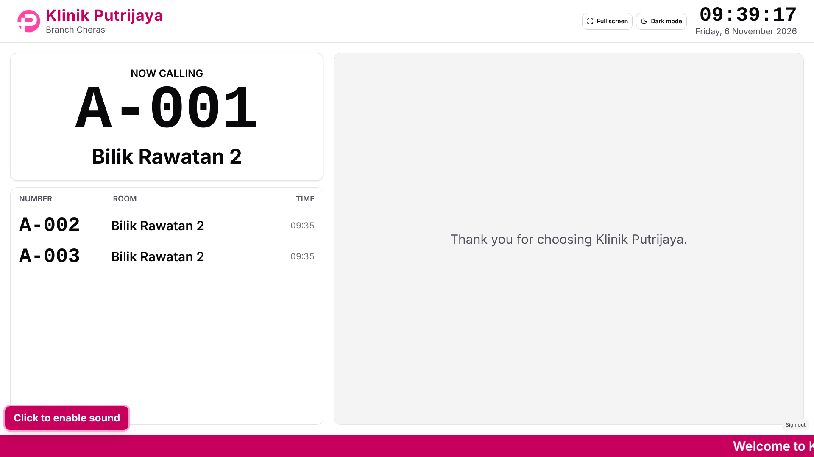
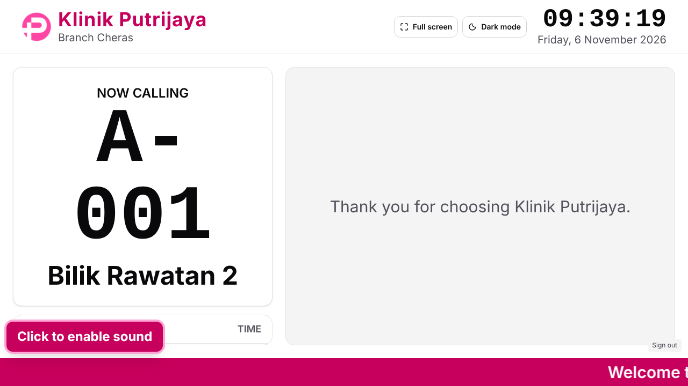
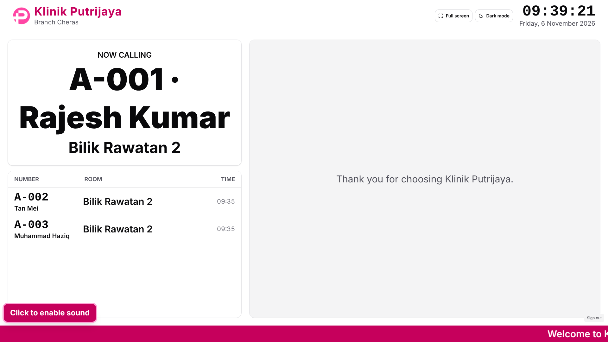
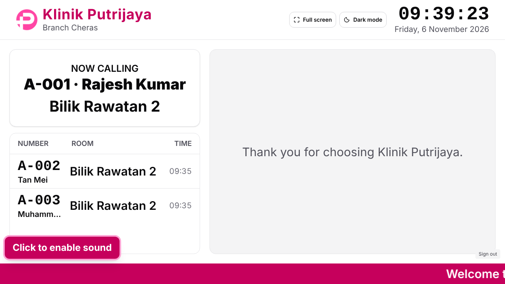
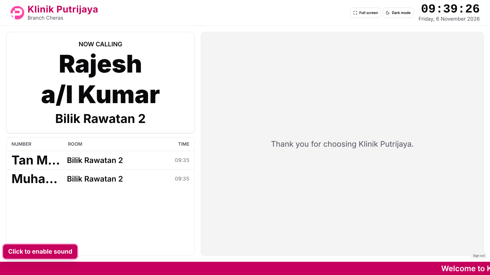
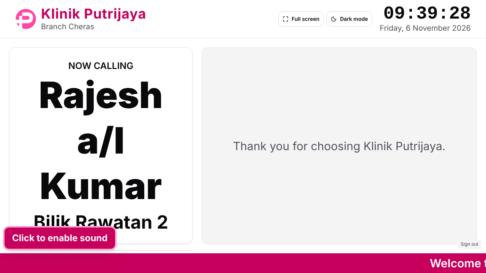

# Waiting-room TV: privacy review pack

Prepared by the Queue & TV team (Amirul, Lead) on 2026-11-06 for the go-live privacy review (owner request,
2026-11-06, relayed by B.E.R.N.I.S.S). It describes what KPOne does today, on `main` after PR #296, so the
reviewer can choose a mode per branch. It is not legal advice and it authorises nothing. All names below are
fictional and the screenshots use synthetic data only.

## 1. In one sentence

Each branch's waiting-room TV calls patients in one of three ways: by **queue number** (the default), by
**number and short name**, or by **full registered name**. Whoever in the waiting room can see the screen or
hear the speaker learns what that mode shows and says.

## 2. The three modes side by side

| | Number (default) | Number and short name | Full name |
|---|---|---|---|
| Current call on the screen | `A-001` | `A-001 · Rajesh Kumar` | `Rajesh a/l Kumar` (no number) |
| Earlier calls in the list | `A-002` | `A-002 Tan Mei` | `Tan Mei Ling` (long names cut short with "…") |
| Spoken, Malay voice | "A, kosong, kosong, satu. Bilik Rawatan 2." | "A, kosong, kosong, satu. Rajesh Kumar. Bilik Rawatan 2." | "Rajesh a/l Kumar. Bilik Rawatan 2." |
| Spoken, English voice | "A, zero, zero, one. Bilik Rawatan 2." | "A, zero, zero, one. Rajesh Kumar. Bilik Rawatan 2." | "Rajesh a/l Kumar. Bilik Rawatan 2." |
| Sent from the server to the TV browser | number, room, service, time | the same, plus the short name only | the same, plus the full registered name |
| Who can tell who the patient is | only the patient (they hold the number) | anyone who knows the patient by name | anyone in the room |
| Added by | TV-1 (PR #57) | Q-3 (PR #274, 2026-11-05) | DS-02b (PR #86, 2026-10-09) |

The spoken lines above were produced by KPOne's own announcement code (`announcementText` in
`resources/js/lib/queue-display.ts`). The screen lines and the server data were read from a real TV session.
A dispensary call without a room says "Farmasi" or "Pharmacy" instead of a room name; for example,
"B, kosong, kosong, empat. Tan Mei. Farmasi."

## 3. Screenshots (1920 × 1080 and 1280 × 720, same three calls)

**Number (default)**

**Number and short name**

**Full name**

The fictional patients were "Rajesh a/l Kumar", "Tan Mei Ling" and "Muhammad Haziq Firdaus bin Abdullah".

## 4. How the short name is made

The server, not the TV, makes the short name, so the full name never reaches the TV in this mode
(`app/Domain/Queue/Display/ShortDisplayName.php`):

- It takes the **first two words** of the registered name.
- It skips the relationship words **bin, binti, bt, bte, a/l, a/p, s/o, d/o** and the **"@"** alias sign, in
  any case and with or without a trailing dot.
- If the two words together are longer than **24 characters**, it shows only the first word. A word is never cut.
- If no usable word is left, the TV shows the number only.

Examples:

| Registered name | Short name |
|---|---|
| Rajesh a/l Kumar | Rajesh Kumar |
| Nurul Aisyah binti Ahmad | Nurul Aisyah |
| Muhammad Haziq Firdaus bin Abdullah | Muhammad Haziq |
| Tan Mei Ling | Tan Mei |

Points the reviewer should know:

- For Chinese-order names, the short name is the surname and the first given name ("Tan Mei"), which is still
  recognisable to people who know the patient.
- In a small waiting room, two words are often enough to identify a person. Short-name mode is gentler than
  full name, not anonymous.
- The spoken call says the short name aloud as well as showing it.

## 5. What stays the same in every mode

- **Default:** a branch uses Number until someone changes it. A new branch starts in Number mode.
- **Who can change the mode:** Director and Administrator for any branch (`queue_display.manage.organisation`),
  a CA Supervisor for the branches they work at (`queue_display.manage.branch`), on the Queue Display settings
  screen. Each change is saved with a version check and recorded in the audit log as
  `queue_display.settings.updated`.
- **The call record holds no patient data.** `queue_calls` stores the number, room, service and time. The name is
  looked up only when the TV asks for its list, and only in the two name modes.
- **What the TV shows:** today's calls at that branch only, the newest one as the current call and up to 8 recent
  calls in the list. A recall is announced again but listed once. After 15 minutes the heading changes from
  "Now calling" to "Last called" (TV-5), and the call stays on the screen.
- **The TV account** (`queue_display` role) sees only its own branch's calls. It has no access to patient
  records, the queue list, clinical or billing data. In the two name modes it does receive the names on the
  screen, so anyone who can open the TV browser can read them.
- **Clinical details are never shown or spoken** in any mode: no diagnosis, no reason for the visit, no doctor's
  name and no payment details.
- **The patient's own QR status page** (on their phone, only after the CA accepts them) is separate. It shows their
  first name and queue number to them, whatever the TV mode is.

## 6. Things the reviewer may want to decide

1. Which mode each branch should use at go-live. The team's suggestion is Number by default, with a name mode
   only where staff find numbers do not work, such as for elderly patients.
2. Whether patients should be told how they will be called, for example on a sign at the counter or in the QR
   privacy notice. The QR privacy notice still has to be approved before real patients use it.
3. Whether a patient can ask to be called by number only even when the branch uses a name mode. KPOne has no
   per-patient opt-out today, so this would need building.
4. Whether full-name mode should be allowed at all, or whether short name should be the most a branch may choose.
5. Who in each branch may change the mode. Today that is Director, Administrator and CA Supervisor.

## 7. Small display notes found while preparing this pack (not privacy decisions)

- In full-name mode the list's column heading still reads "NUMBER" above the names.
- In full-name mode, long names in the earlier-calls list are cut short with "…" ("Tan M…"). The current call
  shows the whole name.

These are cosmetic. They are listed here so they are not lost, and they would be a small Queue & TV change if the
owner wants them fixed.
